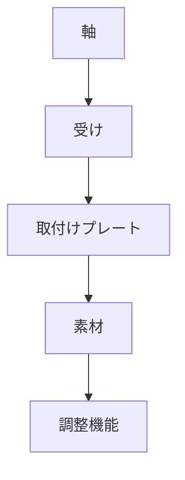

# Day 087: 4社カテゴリの共通点

蝶番（ちょうつがい）やヒンジは、ドアや蓋を開閉する際に使われる機構部品です。これらの部品は、家具や産業機器、車両など、さまざまな場面で使用されています。今日は、タキゲン、シブタニ（APPIT）、栃木屋、スガツネの4社が提供する蝶番・ヒンジの共通点について学びましょう。

まず、蝶番・ヒンジの基本的な役割は、2つの部材を回転軸を中心に連結し、スムーズに開閉できるようにすることです。この回転運動を可能にするために、各社の製品は以下のような共通の仕組みを持っています。

1. **軸と受け**: 蝶番・ヒンジの中心には回転軸があり、これが受けに組み込まれることで回転が可能になります。この軸と受けの組み合わせは、滑らかな動きを実現するために重要です。

2. **取付けプレート**: 各社の製品には、部材に固定するための取付けプレートがあります。これにより、蝶番・ヒンジをしっかりと取り付けることができ、安定した動作を保証します。

3. **素材と仕上げ**: 蝶番・ヒンジは、耐久性や美観を考慮して様々な素材で作られています。ステンレスや亜鉛合金、アルミニウムなどが一般的で、用途に応じて選ばれます。

4. **調整機能**: 一部の製品には、取り付け後に微調整が可能な機能が備わっています。これにより、ドアや蓋の位置を最適に調整することができます。

これらの共通点は、どのメーカーの製品にも見られる基本的な要素です。これらを理解することで、図面が読めなくても、蝶番・ヒンジの仕組みをイメージしやすくなります。

## 図で理解する

## 今日のポイント
- 蝶番・ヒンジは回転軸で動作
- 取付けプレートで安定性確保
- 素材選びが耐久性に影響

## 明日へのつながり
明日は、蝶番・ヒンジの具体的な使用例を通じて、さらに深くその役割を理解していきます。
