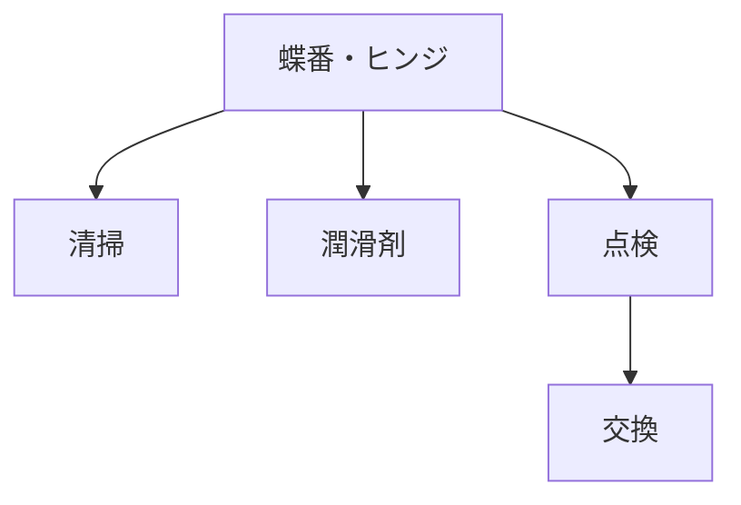

# Day 088: メンテナンスのコツ

蝶番（ちょうばん）やヒンジは、ドアや蓋（ふた）などをスムーズに開閉するための重要な部品です。これらの部品は、日々の使用によって摩耗（まもう）や劣化（れっか）が進むことがあります。そこで、今回は蝶番・ヒンジのメンテナンスのコツについて学びましょう。

## メンテナンスの基本

1. **定期的な清掃**  
   蝶番やヒンジの表面に汚れやほこりがたまると、動きが悪くなることがあります。定期的に柔らかい布やブラシで清掃し、汚れを取り除きましょう。特に、屋外で使用される部品は、雨や風による汚れが付きやすいため注意が必要です。

2. **潤滑剤の使用**  
   蝶番やヒンジの滑らかな動きを保つためには、潤滑剤（じゅんかつざい）の使用が効果的です。潤滑剤は、金属同士の摩擦を減らし、動きをスムーズにします。スプレータイプの潤滑剤を使用し、部品の接合部分に少量を噴霧（ふんむ）しましょう。

3. **部品の点検と交換**  
   定期的に蝶番やヒンジの状態を確認し、異常がないか点検します。ねじの緩みや部品の破損が見つかった場合は、早めに交換することが大切です。特に、重要な機能を担う部品は、些細な不具合でも大きな問題につながる可能性があります。

## 図で理解する

## 今日のポイント
- 定期的な清掃で動きを保つ
- 潤滑剤で摩擦を軽減
- 点検と交換で安全性を確保

## 明日へのつながり
明日は、蝶番・ヒンジの選び方について学びます。用途に応じた最適な部品の選定方法を理解しましょう。
