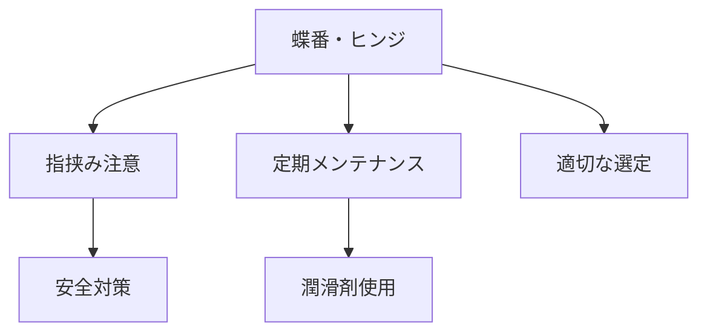

# Day 089: 安全上の注意

蝶番（ちょうつがい）やヒンジは、扉や蓋がスムーズに動くための重要な部品です。しかし、これらの部品は動く部分を持つため、使用時にはいくつかの安全上の注意が必要です。今回は、図面が読めなくても理解できるように、一般的な安全上の注意点を解説します。

まず、蝶番やヒンジは開閉時に指や手を挟む危険があります。特に、重い扉や蓋に使用されている場合、その危険性は高まります。使用時には、開閉の際に手や指が挟まれないよう注意しましょう。また、子供やペットがいる環境では、誤って触れないようにする工夫が必要です。

次に、蝶番やヒンジは適切なメンテナンスが必要です。錆びや汚れが蓄積すると、動きが悪くなり、開閉時に余計な力が必要になることがあります。これにより、部品が破損したり、突然動いて怪我をするリスクが増します。定期的に清掃し、必要に応じて潤滑剤を使用してスムーズな動きを保つことが重要です。

さらに、取り付け時には、適切なサイズと種類の蝶番やヒンジを選ぶことが大切です。誤った選択は、部品の過剰な負荷や早期の故障を引き起こす可能性があります。例えば、重い扉にはそれに見合った強度のあるヒンジを選ぶ必要があります。選定に不安がある場合は、専門家に相談することをお勧めします。

## 図で理解する

## 今日のポイント
- 蝶番・ヒンジは指挟みに注意
- 定期的なメンテナンスが必要
- 適切なサイズと種類を選定

## 明日へのつながり
明日は、蝶番・ヒンジの取り付け方法について詳しく学びます。安全に取り付けるための基本を理解しましょう。
