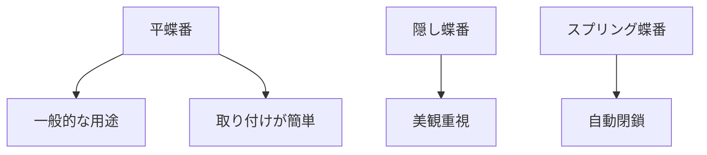

# Day 090: 蝶番カテゴリまとめ

蝶番（ちょうばん）やヒンジは、扉や蓋を開閉するための重要な部品です。これらは日常生活や産業機械において広く使用されていますが、種類が多いため選択が難しいと感じるかもしれません。今日は、蝶番・ヒンジの基本的なカテゴリとその用途について学びましょう。

まず、蝶番とヒンジの違いについて簡単に説明します。一般的に、蝶番は扉や蓋を開閉するための単純な機構を指し、ヒンジはその中でも特に耐久性や機能性が求められるものを指すことがあります。どちらも同じように使われることが多いですが、用途によって選び方が異なります。

### 蝶番の主な種類

1. **平蝶番**: 最も一般的なタイプで、扉や蓋を開閉する際に使用されます。シンプルな構造で取り付けが容易です。

2. **ピアノ蝶番**: 長い連続した蝶番で、均一な支持が必要な長い扉や蓋に適しています。ピアノの蓋に使われることからこの名前が付いています。

3. **隠し蝶番**: 扉を閉じたときに蝶番が見えないように設計されています。家具やキャビネットなど、美観を重視する場面で使用されます。

4. **スプリング蝶番**: 自動的に扉を閉じる機能を持ち、扉が常に閉まっている状態を保ちたい場合に便利です。

5. **リフティング蝶番**: 扉を開ける際に少し持ち上げる機能があり、床面を傷つけないように設計されています。

### 蝶番の選び方

蝶番を選ぶ際には、以下のポイントを考慮することが重要です。

- **使用環境**: 屋内か屋外か、湿度や温度の変化が激しい場所かどうかを考慮します。
- **重量とサイズ**: 扉や蓋の重量とサイズに応じた耐荷重の蝶番を選びます。
- **美観**: 見た目が重要な場合は、隠し蝶番や装飾性のあるものを選ぶと良いでしょう。

## 図で理解する

## 今日のポイント
- 蝶番とヒンジの違いを理解する
- 主な蝶番の種類と用途を知る
- 適切な蝶番の選び方を学ぶ

## 明日へのつながり
明日は、蝶番の取り付け方法とその際の注意点について詳しく学びます。正しい取り付けが機能性を左右しますので、ぜひご期待ください。
