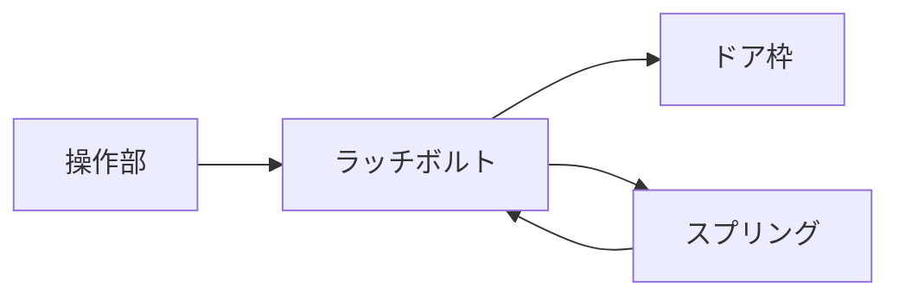

# Day 091: ラッチとは何か

ラッチは、ドアや蓋を開閉する際に使われる重要な機構部品です。日常生活で何気なく使っているドアや収納の扉にも、このラッチが組み込まれていることが多く、開閉をスムーズに行うために欠かせない存在です。

## ラッチの基本的な仕組み

ラッチは、ドアや蓋を閉じた状態で固定し、必要に応じて簡単に開けられるようにする機構です。一般的には、ドアノブやハンドルと連動して動作します。ラッチが閉じると、ドアや蓋がしっかりと固定され、開くときにはノブやハンドルを操作することでラッチが解除されます。

### ラッチの構成要素

1. **ラッチボルト**: ドアや蓋を固定するために突き出す部分です。ドア枠や受け金具に引っかかることで固定されます。
2. **スプリング**: ラッチボルトを常に前方に押し出す力を提供します。これにより、ドアを閉じた際に自動的にラッチボルトが出て固定されます。
3. **操作部**: ドアノブやハンドルに連動してラッチボルトを引っ込める部分です。これにより、ドアや蓋を開けることができます。

## 図で理解する

## 今日のポイント
- ラッチはドアや蓋を固定する部品
- スプリングで自動的に固定される
- 操作部で簡単に解除可能

## 明日へのつながり
明日は、ラッチと錠前の違いについて詳しく学び、どのように選定すべきかを考えていきます。
