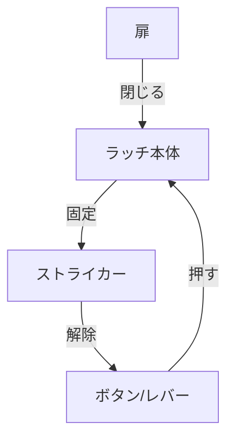

# Day 092: 平面ラッチの動き

今日は「平面ラッチ」の動きについて学びます。平面ラッチは、扉や蓋を簡単に開閉できるようにするための部品です。特に、工具を使わずに手で操作できる点が特徴です。これにより、日常的な操作が非常にスムーズになります。

平面ラッチは、通常、扉の内側に取り付けられます。扉を閉じると、ラッチの一部が固定され、扉がしっかりと閉まった状態になります。開けるときは、ラッチのボタンやレバーを押すだけで、固定が解除されます。この動作は、機械的な仕組みによって行われ、スプリングやカム（回転する部品）が重要な役割を果たしています。

### 平面ラッチの基本構造

1. **ラッチ本体**: 扉に取り付けられる部分で、固定と解除の機能を持ちます。
2. **ストライカー**: 扉枠に取り付けられる部分で、ラッチ本体と噛み合うことで固定されます。
3. **スプリング**: ラッチを自動で元の位置に戻すために使われます。
4. **ボタンまたはレバー**: ラッチを解除するために押す部分です。

### 動作の流れ

1. **扉を閉じる**: ラッチ本体がストライカーに噛み合い、扉が固定されます。
2. **扉を開ける**: ボタンやレバーを押すと、スプリングの力でラッチが解除され、扉が開きます。

このように、平面ラッチはシンプルな動きでありながら、確実に扉を固定する役割を果たしています。これにより、安全性が高まり、操作性も向上します。

## 図で理解する

## 今日のポイント
- 平面ラッチは扉の固定と解除が簡単
- スプリングとカムが動作の要
- 手動操作で工具不要

## 明日へのつながり
明日は、ラッチの素材とその選び方について学びます。適切な素材選びが、ラッチの性能を左右します。
