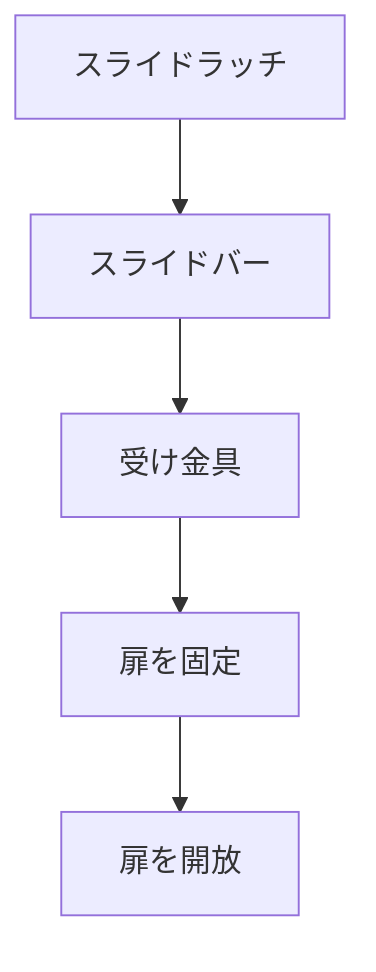

# Day 093: スライドラッチの動き

スライドラッチは、引き戸やキャビネットの扉を固定するために使われる機構部品です。名前の通り、ラッチ部分がスライドすることで、扉を開けたり閉めたりすることができます。この仕組みは、シンプルでありながらも非常に効果的です。

## スライドラッチの基本構造

スライドラッチは主に以下のような部品で構成されています：

1. **ラッチ本体**: 扉に取り付けられる部分で、スライドする部品が内蔵されています。
2. **スライドバー**: ラッチ本体の中で動く部分で、手動で前後に動かすことができます。
3. **受け金具**: 扉の枠や反対側に取り付けられ、スライドバーが引っかかることで扉を固定します。

## スライドラッチの動き

スライドラッチの動きは非常にシンプルです。通常、スライドバーを手で操作することで、バーが受け金具に引っかかり、扉が固定されます。逆に、バーを引いて受け金具から外すことで、扉を開けることができます。この動きは、扉の開閉を簡単に制御するために設計されています。

スライドラッチは、特に頻繁に開閉する扉に向いています。例えば、キャビネットや工具箱の扉などでよく見られます。このような場所では、簡単に開閉できることが求められるため、スライドラッチのシンプルな操作が非常に便利です。

## 図で理解する

## 今日のポイント
- スライドラッチは手動でスライドさせる
- 扉を簡単に固定・開放できる
- 引き戸やキャビネットに最適

## 明日へのつながり
明日は、スライドラッチの取り付け方法と、注意すべきポイントについて学びます。スライドラッチの選び方にも触れていきます。
