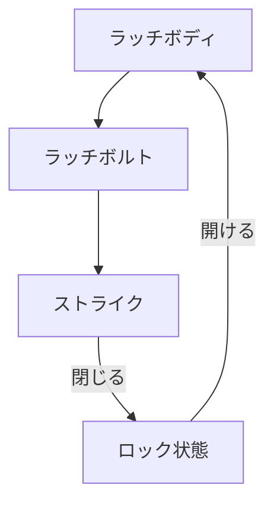

# Day 094: パチン錠の仕組み

パチン錠は、ドアや蓋を閉める際に「パチン」と音を立てて自動的にロックされる便利な機構です。この錠前は、特に頻繁に開閉する場所で役立ちます。例えば、家庭の収納扉や産業用機器のカバーなどに使用されます。パチン錠の最大の特徴は、手を使わずに簡単に閉められることです。

## パチン錠の基本構造

パチン錠は主に以下の要素で構成されています：

1. **ラッチボディ**: 錠前の本体部分で、内部にバネが組み込まれています。このバネの力でラッチボルトが前後に動きます。
   
2. **ラッチボルト**: ドアや蓋を閉めたときに、相手側のストライク（受け金具）に引っ掛かる部品です。ラッチボルトはバネの力で常に前方に押し出されています。

3. **ストライク**: ドア枠や蓋の受け側に取り付けられる金具で、ラッチボルトが引っ掛かる部分です。

## パチン錠の動作原理

1. **ドアを閉める**: ドアや蓋を閉めると、ラッチボルトがストライクに当たります。このとき、ラッチボルトはバネの力で一時的に押し戻されます。

2. **ロック状態**: ドアや蓋が完全に閉じると、ラッチボルトがストライクの受け部分に収まり、バネの力で元の位置に戻ります。この状態でドアや蓋はロックされます。

3. **開けるとき**: ドアノブやハンドルを操作すると、ラッチボルトが引っ込んでストライクから外れ、ドアや蓋を開けることができます。

このように、パチン錠は特別な操作を必要とせずに閉じるだけでロックされるため、利便性が高いのが特徴です。

## 図で理解する

## 今日のポイント
- パチン錠は自動でロックされる
- バネの力でラッチボルトが動く
- ストライクが受け金具として機能

## 明日へのつながり
明日は、パチン錠の応用例とその利便性について詳しく見ていきます。これにより、どのような場面でパチン錠が最適か理解を深めましょう。
