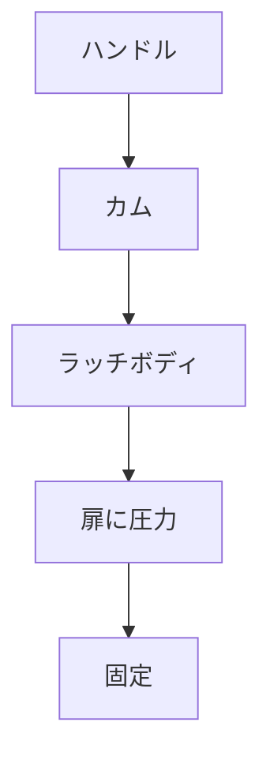

# Day 095: コンプレッションラッチ

コンプレッションラッチは、産業用の扉やパネルをしっかりと閉じるための機構です。このラッチは、単に扉を固定するだけでなく、圧縮機能を持つことで振動や衝撃に対する耐性を高めています。特に、機械装置や制御盤など、外部からの振動が多い環境で重宝されます。

## コンプレッションラッチの仕組み

コンプレッションラッチは、一般的にハンドルやノブを回すことで動作します。ハンドルを回すと、内部のカム（円盤状の部品）が回転し、ラッチボディが前後に動きます。この動きにより、扉やパネルをしっかりと押し付けることができ、密閉性を高めます。

1. **ハンドルの回転**: ハンドルを回すと、内部のカムが回転します。
2. **カムの動き**: カムの回転によって、ラッチボディが前後に動きます。
3. **圧縮機能**: ラッチボディが扉を押し付けることで、圧縮が生じ、しっかりと固定されます。

この圧縮機能により、扉やパネルは振動や衝撃に対する耐性が向上します。また、密閉性が必要な場面でも効果を発揮します。

## 図で理解する

## 今日のポイント
- コンプレッションラッチは圧縮機能を持つ
- 振動や衝撃に強い
- ハンドルを回すことで動作

## 明日へのつながり
明日は、コンプレッションラッチの具体的な使用例を通じて、さらにその利便性を理解していきます。
