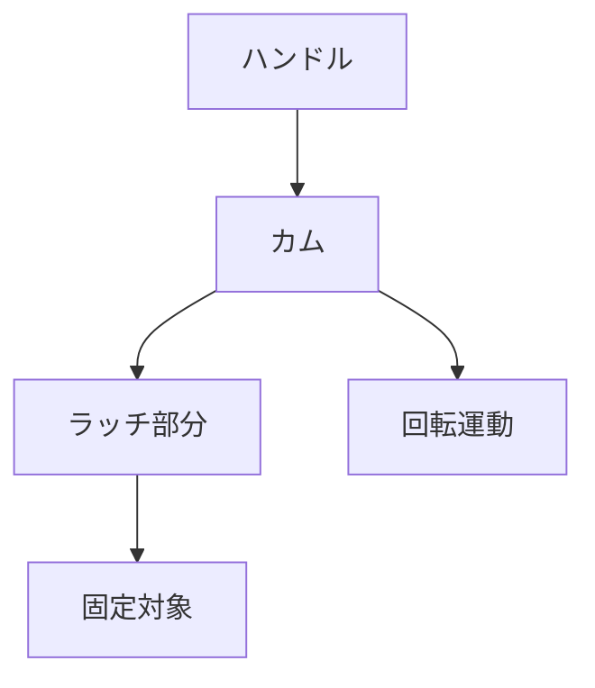

# Day 096: キャムラッチの基礎

キャムラッチは、扉やパネルを固定するために使われる機構部品です。キャムラッチの特徴は、その操作の簡単さと確実な締め付けです。回転運動を利用して、ラッチ部分が固定対象にしっかりと接触し、安定した固定を提供します。

## キャムラッチの仕組み

キャムラッチは、主に以下の3つの部分で構成されています。

1. **ハンドル**: 手で回す部分です。これを回転させることで、ラッチが動作します。
2. **カム**: ハンドルの回転により動く部分で、固定対象を押さえる役割を果たします。カムは、特定の形状を持ち、回転によりラッチ部分を前後に動かします。
3. **ラッチ部分**: 扉やパネルを実際に押さえる部分です。カムの動きにより、固定対象にしっかりと接触します。

キャムラッチは、ハンドルを回すだけで、簡単に固定と解放ができるため、頻繁な開閉が必要な場所に適しています。

## キャムラッチの用途

キャムラッチは、産業用機器のカバーや制御盤の扉、機械のアクセスパネルなど、さまざまな場面で使用されます。特に、工具を使わずに手で操作できるため、メンテナンスが頻繁な場所で重宝されます。

## 図で理解する

## 今日のポイント
- キャムラッチは回転運動で固定
- ハンドル操作が簡単で便利
- 工具不要で頻繁な開閉に最適

## 明日へのつながり

明日は、キャムラッチの応用例について学び、実際の使用シーンでの利便性をさらに深掘りします。
