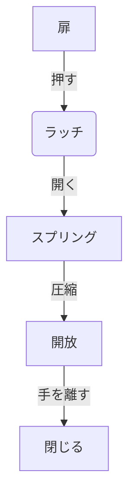

# Day 097: プッシュラッチ

プッシュラッチは、扉や蓋を押すだけで開閉できる便利な機構部品です。このラッチは、通常は閉じた状態で保持されており、押すことで開く仕組みになっています。プッシュラッチは、家具や電化製品、産業用機器など、様々な場面で利用されています。

## プッシュラッチの仕組み

プッシュラッチの基本的な構造は、スプリング（ばね）とラッチ本体から成り立っています。通常、ラッチはスプリングの力で閉じた状態を保ちます。使用者が扉や蓋を押すと、スプリングが圧縮され、ラッチが開く仕組みです。この動作は「ワンタッチ」で行えるため、手軽に開閉が可能です。

### 使用例

1. **家具の扉**: プッシュラッチは、取っ手のない家具の扉に多く使われています。見た目がすっきりし、デザイン性を高めることができます。
   
2. **電化製品のカバー**: 家電製品のバッテリーカバーやメンテナンス用カバーに使用され、工具を使わずに簡単に開閉できます。

3. **産業用機器**: 制御盤や点検口など、頻繁に開閉する必要がある箇所に使用されます。

## プッシュラッチの利点

- **簡単操作**: 押すだけで開閉できるため、誰でも簡単に使用できます。
- **安全性**: 確実に固定されるため、振動や衝撃で勝手に開くことが少ないです。
- **デザイン性**: 取っ手が不要なため、シンプルで美しいデザインが可能です。

## 図で理解する

## 今日のポイント
- プッシュラッチは押すだけで開閉
- スプリングで確実に固定
- 家具や機器で広く利用

## 明日へのつながり
明日は、プッシュラッチと似た動作を持つ「マグネットラッチ」について学び、さらに理解を深めていきましょう。
