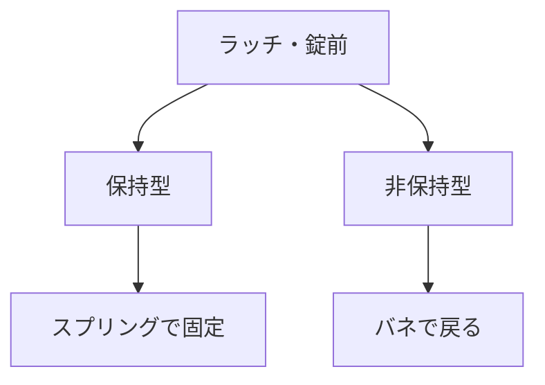

# Day 098: 保持型と非保持型

ラッチや錠前は、物を固定したり開閉したりするための重要な部品です。これらには「保持型」と「非保持型」の2つのタイプがあります。今日は、この2つのタイプの違いと、それぞれの仕組みについて学びましょう。

## 保持型ラッチ・錠前

保持型のラッチや錠前は、一度閉じると自動的に固定され、再度操作するまでその状態を保ちます。例えば、ドアを閉めたときにカチッと音がしてロックされるタイプです。このタイプは、ドアやフタが自然に開かないようにするために使われます。

### 仕組み

保持型は、内部にスプリングやロック機構を持っており、これが閉じた状態を維持します。開ける際には、ハンドルやボタンを操作してロックを解除します。この仕組みは、安定した固定が必要な場所に適しています。

## 非保持型ラッチ・錠前

一方、非保持型は、操作したときのみ一時的に固定されるタイプです。例えば、押して開くタイプのキャビネットなどに使われます。操作を止めると、すぐに元の状態に戻ります。

### 仕組み

非保持型は、通常バネの力を利用しており、操作がないときには常に開いた状態に戻るようになっています。このため、頻繁に開閉する必要がある場所や、開けたままにしておきたい場合に便利です。

## 図で理解する

## 今日のポイント
- 保持型は自動で固定される
- 非保持型は一時的に固定される
- 用途に応じて選択が重要

## 明日へのつながり
明日は、ラッチや錠前の選び方について、具体的な用途に応じたポイントを詳しく見ていきます。
