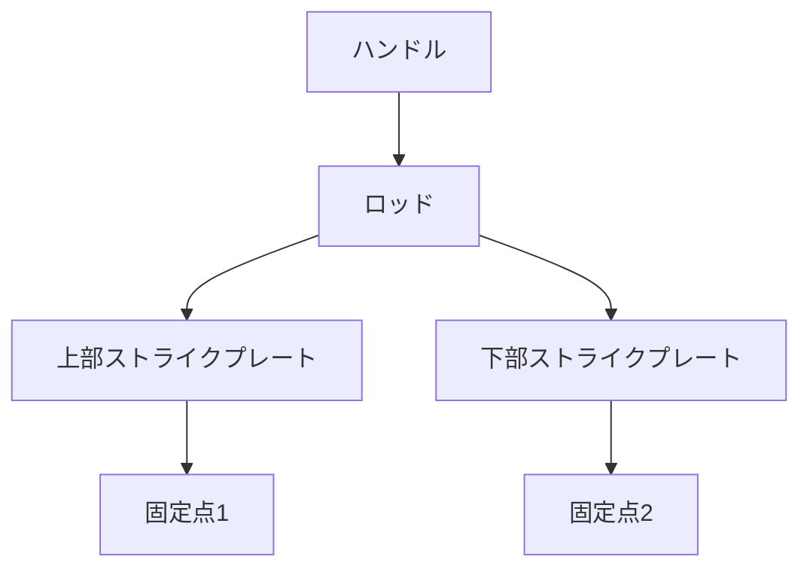

# Day 099: 2点式（2P）ラッチ

2点式（2P）ラッチは、扉や蓋を2つのポイントで固定するための機構部品です。通常のラッチが1点での固定に対し、2点式ラッチは2つの異なる位置で同時に固定することで、より高い安全性と密閉性を提供します。この仕組みは、特に大型の扉や重い蓋において重要です。1点での固定では、扉がたわんだり、密閉が不十分になる可能性がありますが、2点式ラッチはこれを防ぎます。

## 2点式ラッチの仕組み

2点式ラッチは、一般的に以下のような構造を持っています：

1. **ハンドル**: 操作部で、これを回すか引くことでラッチが動作します。
2. **ロッド**: ハンドルの動きに連動して上下に動く棒状の部品です。このロッドが2つの固定点を作り出します。
3. **ストライクプレート**: ロッドが引っかかる部分で、扉や蓋の枠に取り付けられます。

ハンドルを操作すると、ロッドが上下に動き、ストライクプレートに引っかかることで扉や蓋を固定します。この動作により、2つの異なる位置でしっかりと固定されるため、振動や衝撃に対する耐性が高まります。

## 使用例

2点式ラッチは、以下のような場面でよく使用されます：

- **工場の大型機械の扉**: 機械の内部にアクセスするための扉で、密閉性が要求される場合。
- **輸送用コンテナの蓋**: 長距離輸送中の振動に耐えるため、しっかりと固定する必要がある場合。
- **冷蔵庫や冷凍庫の大型扉**: 温度管理が重要なため、隙間なく閉じることが求められる場合。

## 図で理解する

## 今日のポイント
- 2点式ラッチは2つの固定点で安全性を向上
- ハンドル操作でロッドが動き、固定を実現
- 大型扉や蓋での使用が一般的

## 明日へのつながり
明日は、ラッチの耐久性を高めるための材料選びについて学びます。これにより、適切なラッチの選定ができるようになります。
