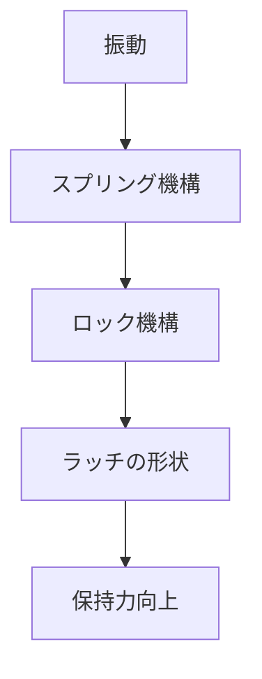

# Day 100: 耐振動ラッチ

耐振動ラッチは、振動が発生する環境で使用されるラッチの一種です。例えば、工場の機械や車両のドアなど、振動が頻繁に発生する場所で活躍します。このラッチは、振動によって不意に開かないように設計されています。

## 耐振動ラッチの仕組み

耐振動ラッチは、通常のラッチに比べて、より強固な保持力を持っています。これは、内部に特殊な機構が組み込まれているためです。この機構は、振動を受けてもラッチが解除されないようにするためのものです。

一般的に、耐振動ラッチは以下のような仕組みを持っています：

1. **スプリング機構**: 振動を吸収するために、スプリングが使われることがあります。これにより、ラッチが振動によって動かないようにします。
2. **ロック機構**: ラッチが完全に閉じられた状態で、追加のロック機構が働きます。これにより、振動による意図しない開放を防ぎます。
3. **ラッチの形状**: ラッチ自体の形状が、振動に対して安定するように設計されています。例えば、カムやフックの形状が工夫されています。

## 図で理解する

## 今日のポイント
- 耐振動ラッチは振動環境での保持力を強化
- スプリングやロック機構が振動を吸収
- 振動に強い形状で意図しない開放を防止

## 明日へのつながり
明日は、耐振動ラッチの具体的な応用例について学びます。どのような場面で使われているのかを見ていきましょう。
