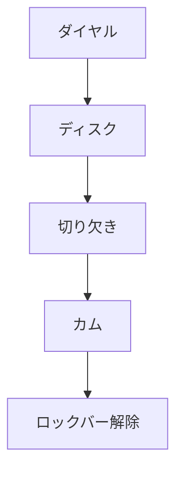

# Day 102: ダイヤル錠の基礎

ダイヤル錠は、番号を組み合わせて開閉するタイプの錠前です。鍵を持ち歩く必要がないため、利便性が高く、ロッカーやキャビネットなどで広く使用されています。今回は、ダイヤル錠の基本的な仕組みとその役割について学びましょう。

## ダイヤル錠の仕組み

ダイヤル錠は、通常、複数のダイヤルが並んでおり、それぞれのダイヤルには数字が刻まれています。ユーザーは事前に設定された番号を順番に合わせることで、錠を開けることができます。この仕組みは、以下のように動作します。

1. **ダイヤルの回転**: 各ダイヤルを回すことで、内部のディスクが回転します。ディスクには特定の位置に切り欠きがあり、これが正しい番号に合わせると、全てのディスクの切り欠きが一直線に並びます。

2. **カムの動き**: 切り欠きが一直線に並ぶと、内部のカムと呼ばれる部品が動くことができるようになります。このカムが動くことで、錠が解除されます。

3. **ロックの解除**: カムが動くと、ロックバーが引っ込み、扉や引き出しが開けられるようになります。

## ダイヤル錠の利点

- **鍵不要**: 鍵を持ち歩く必要がないため、紛失のリスクが低減されます。
- **セキュリティ**: 番号の組み合わせを変更することで、簡単にセキュリティレベルを調整できます。
- **耐久性**: 機械的な構造がシンプルなため、故障が少なく、長期間使用できます。

## 図で理解する

## 今日のポイント
- ダイヤル錠は番号で開閉
- 鍵不要で管理が簡単
- セキュリティ調整が容易

## 明日へのつながり
明日は、ダイヤル錠の応用として、電子化されたダイヤル錠について学びます。これにより、さらなるセキュリティ強化が可能になります。
