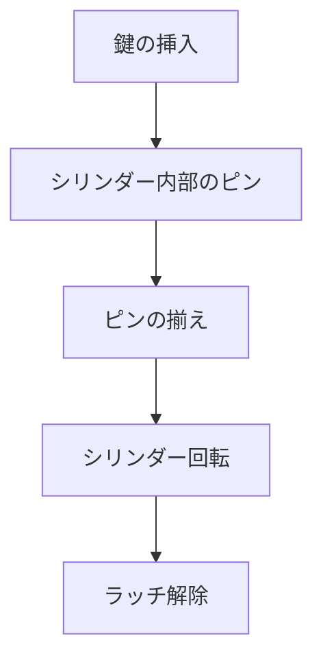

# Day 103: キー付き錠前

キー付き錠前は、鍵を使って開閉する仕組みを持つ錠前です。このタイプの錠前は、セキュリティやアクセス制御が必要な場所でよく使用されます。例えば、オフィスのドアや機器の保護ケースなどで見かけることが多いでしょう。

## キー付き錠前の仕組み

キー付き錠前の基本的な仕組みは、鍵を挿入し回すことで内部のピンやディスクが動き、ラッチ（掛け金）が解除されるというものです。以下に、一般的なキー付き錠前の動作を説明します。

1. **鍵の挿入**: 鍵を錠前のシリンダー（円筒形の部分）に挿入します。このシリンダーは鍵の形状に合った溝があり、正しい鍵でなければ回りません。

2. **ピンやディスクの動き**: 鍵を回すと、シリンダー内部のピンやディスクが持ち上がり、特定の位置に揃います。この動きが正しく行われることで、シリンダーが回転可能になります。

3. **ラッチの解除**: シリンダーが回転すると、ラッチが引っ込むか、別の位置に移動します。これにより、ドアや蓋が開くようになります。

## 図で理解する

## 今日のポイント
- キー付き錠前は鍵で開閉する
- シリンダーがピンやディスクを動かす
- ラッチが解除されると開く

## 明日へのつながり
明日は、キー付き錠前の応用として、複数の鍵を使ったシステムについて学びます。これにより、さらなるセキュリティ強化が可能になります。
