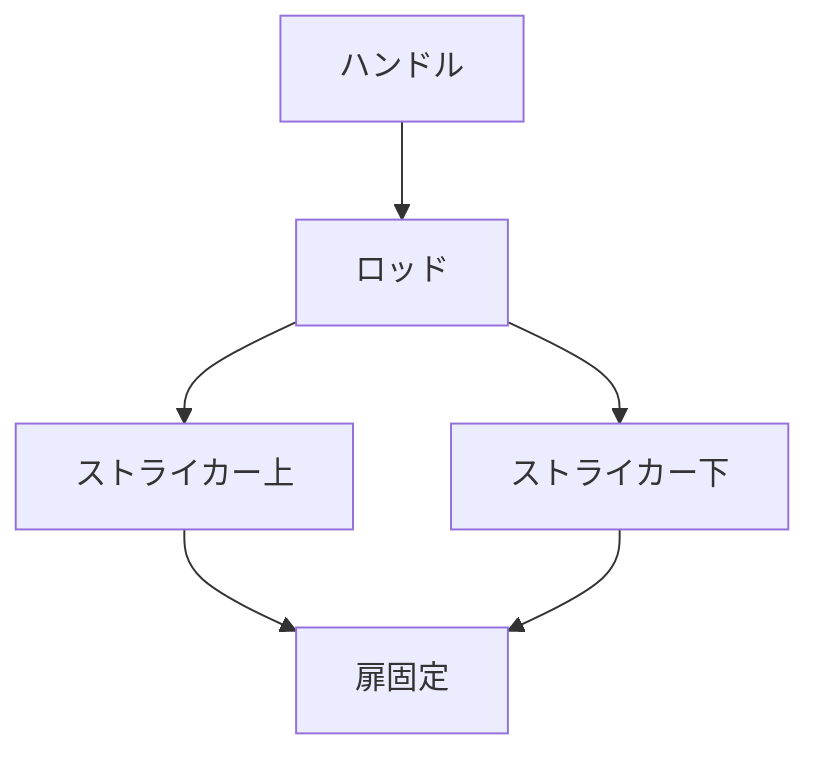

# Day 104: ロッド連動錠前

ロッド連動錠前とは、複数の扉を一度に施錠または解錠するための機構です。主に産業用機器や大型キャビネットで使用され、効率的な施錠操作を可能にします。この錠前は、一本または複数の「ロッド」と呼ばれる棒状の部品を連動させることで、複数のポイントを同時に操作します。

## ロッド連動錠前の仕組み

ロッド連動錠前は、主に以下のような部品で構成されています：

1. **ハンドル**: 手動で操作する部分です。ハンドルを回すことで、ロッドが動きます。
2. **ロッド**: 扉の上下に配置される棒状の部品です。ハンドルの操作により、上下に動きます。
3. **ストライカー**: ロッドの先端が引っかかる部分で、扉を固定します。

ハンドルを操作すると、ロッドが上下に動き、ストライカーに引っかかることで扉が施錠されます。逆にハンドルを反対に回すと、ロッドがストライカーから外れ、扉が解錠されます。

## 利用シーン

ロッド連動錠前は、特に以下のような場面で有効です：

- **大型キャビネット**: 複数の扉を同時に施錠することで、セキュリティを向上させます。
- **産業用機器**: 機械の安全カバーなど、頻繁に開閉する必要がある箇所で使用されます。

この錠前の利点は、操作が簡単でありながら高い安全性を提供する点です。特に、複数のロッドを連動させることで、施錠ポイントが増え、強度が向上します。

## 図で理解する

## 今日のポイント
- ロッド連動錠前は複数扉を同時施錠
- ハンドル操作でロッドが上下に動く
- 産業用機器での安全性向上に寄与

## 明日へのつながり
明日は、ロッド連動錠前の応用例として、特定の産業分野での利用事例を詳しく見ていきます。
