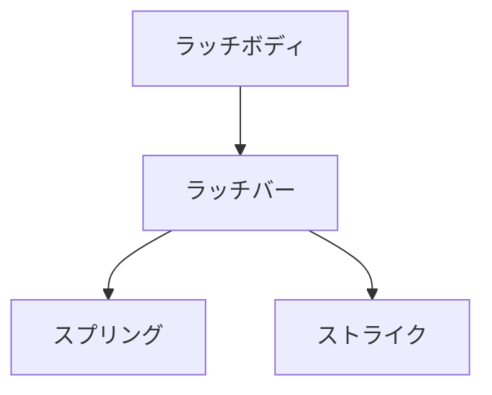

# Day 105: 扉の閉じ力とラッチ

ラッチは、扉や蓋を確実に閉じた状態に保つための機構部品です。家庭用のドアから産業用の機械まで、さまざまな場面で使用されています。今日は、ラッチの「閉じ力」について学びます。閉じ力とは、ラッチが扉を閉じた状態に維持するための力のことです。

## ラッチの基本構造

ラッチは主に以下の要素で構成されています。

1. **ラッチボディ**: ラッチ全体を支える部分。
2. **ラッチバー**: 扉や蓋を固定するために動く部分。
3. **スプリング**: ラッチバーを元の位置に戻すためのばね。
4. **ストライク**: ラッチバーがかかる相手側の部品。

これらの要素が組み合わさることで、ラッチは扉をしっかりと閉じることができます。

## 閉じ力の仕組み

閉じ力は、主にスプリングの力によって生み出されます。スプリングはラッチバーを押し戻す役割を果たし、これによりラッチバーがストライクにしっかりとかかります。スプリングの強さやラッチの設計によって、閉じ力の強さが変わります。

### 閉じ力の調整

ラッチの閉じ力は、以下の方法で調整できます。

- **スプリングの交換**: より強いスプリングに交換することで、閉じ力を増すことができます。
- **ラッチの位置調整**: ラッチとストライクの位置を微調整することで、適切な閉じ力を得ることができます。

## 図で理解する

## 今日のポイント
- ラッチは扉を閉じるための重要な部品
- 閉じ力はスプリングで調整可能
- 適切なラッチ選定が重要

## 明日へのつながり
明日は、ラッチの種類と用途について詳しく学びます。どのような場面でどのラッチを選ぶべきかを理解しましょう。
