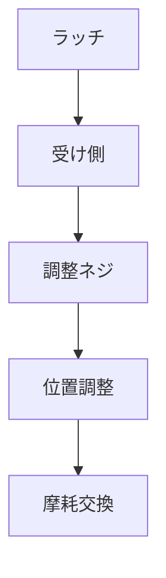

# Day 106: ガタつき調整

ラッチや錠前を使用する際、扉がしっかりと閉まらない、または開けるときにガタつくといった問題が発生することがあります。このようなガタつきは、扉の安定性や安全性に影響を与えるため、適切に調整することが重要です。

## ガタつきの原因

ガタつきの主な原因は、ラッチや錠前の取り付け位置が適切でないこと、または使用による部品の摩耗です。これにより、ラッチがしっかりと受け側にかからず、扉がぐらつくことがあります。

## ガタつき調整の基本

1. **ラッチ位置の調整**: ラッチの位置を微調整することで、扉がしっかりと閉まるようにします。ラッチが受け側に正確にかかるように、取り付け位置を確認し、必要に応じてネジを緩めて調整します。

2. **受け側の調整**: ラッチがかかる受け側の位置も重要です。受け側の位置がずれていると、ラッチが正しくかかりません。受け側のプレートを調整し、ラッチがスムーズにかかるようにします。

3. **摩耗部品の交換**: 長期間使用していると、ラッチや受け側の部品が摩耗することがあります。摩耗がひどい場合は、部品を交換することが必要です。交換することで、再びしっかりとした閉まりを実現できます。

## 図で理解する

## 今日のポイント
- ガタつきはラッチ位置のズレが原因
- 受け側の位置調整が重要
- 摩耗部品は交換が必要

## 明日へのつながり

明日は、ラッチや錠前の選定基準について学びます。適切な部品選びが、ガタつきの発生を未然に防ぐ鍵となります。
