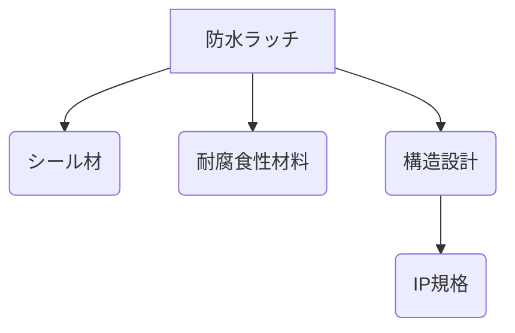

# Day 107: 防水ラッチの考え方

防水ラッチは、特定の環境で使用される際に水の侵入を防ぐために設計されたラッチです。産業用機器や屋外設備など、湿気や水が問題となる場所で使用されます。防水ラッチの基本的な考え方を理解することで、適切な選定と使用が可能になります。

## 防水ラッチの仕組み

防水ラッチは、主に以下の3つの要素で構成されています。

1. **シール材**: 水の侵入を防ぐために、ラッチの接触部分にゴムやシリコンなどのシール材が使用されます。このシール材がしっかりと密閉されることで、防水性能が確保されます。

2. **耐腐食性材料**: 水や湿気にさらされる環境では、ラッチ自体が腐食しないことが重要です。ステンレスや特殊コーティングされた金属が一般的に使用されます。

3. **構造設計**: ラッチの形状や構造も防水性能に寄与します。例えば、ラッチが閉じたときに水が流れやすい形状に設計されていることが多いです。

## 防水ラッチの選び方

防水ラッチを選ぶ際には、使用環境を考慮することが重要です。以下のポイントを確認しましょう。

- **IP規格**: 防水性能はIP規格で評価されます。IP67やIP68などの表示があり、数字が大きいほど防水性能が高いです。
- **使用温度範囲**: 極端な温度での使用が想定される場合、対応可能な温度範囲を確認します。
- **取り付け方法**: 設置場所に適した取り付け方法を選ぶことも重要です。

## 図で理解する

## 今日のポイント
- 防水ラッチは水の侵入を防ぐ
- シール材と耐腐食性が重要
- IP規格で防水性能を確認

## 明日へのつながり
次回は、特定の環境におけるラッチの選定基準について詳しく学びます。防水以外の要素も考慮に入れた選び方を見ていきましょう。
