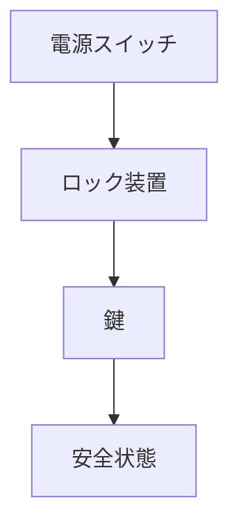

# Day 108: ロックアウト対応

ロックアウト対応は、産業機械や設備の安全性を確保するための重要な仕組みです。特に、メンテナンスや修理作業中に機械が誤って動作しないようにするために使われます。これにより、作業者の安全を守ることができます。

## ロックアウトとは？

ロックアウトとは、機械や設備の動力源を物理的に遮断し、操作できない状態にすることを指します。これにより、作業中に機械が誤作動するリスクを排除します。具体的には、電源スイッチやバルブに専用のロック装置を取り付け、鍵をかけることで動作を防ぎます。

## ラッチ・錠前の役割

ラッチや錠前は、ロックアウト対応の一環として重要な役割を果たします。これらの部品は、扉やカバーをしっかりと固定し、無断での開閉を防ぎます。特に、ラッチは簡単に操作できるため、作業効率を損なわずに安全性を確保することができます。

## ロックアウト対応の実施例

1. **電源の遮断**: 電気機器の場合、ブレーカーをオフにし、ロックアウト装置を取り付けます。
2. **バルブの固定**: 流体を扱う設備では、バルブを閉じた状態でロックし、流体の流れを止めます。
3. **鍵の管理**: 作業者が持つ鍵でのみ解除できるようにすることで、誤操作を防ぎます。

## 図で理解する

## 今日のポイント
- ロックアウトは安全確保の基本
- ラッチは無断開閉を防ぐ
- 鍵管理で誤操作防止

## 明日へのつながり
明日は、ラッチと錠前の耐久性について学びます。長期間の使用に耐える設計のポイントを探ります。
