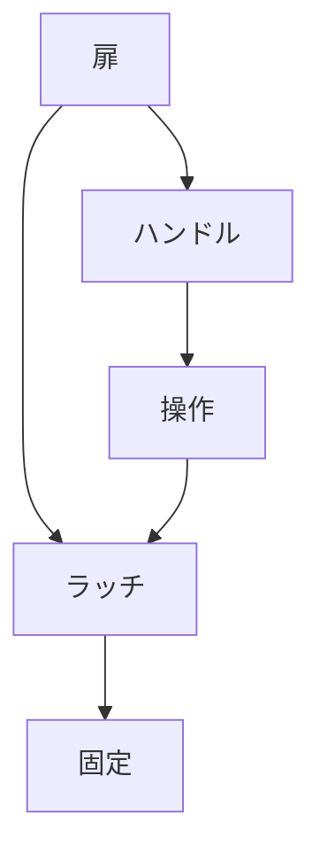

# Day 109: ラッチとハンドルの違い

産業用金具の中で、ラッチとハンドルは非常に重要な役割を果たしますが、その違いを明確に理解することは、特に異業種から転職してきた方にとっては難しいかもしれません。ここでは、図面が読めなくても理解できるように、ラッチとハンドルの基本的な仕組みと役割について解説します。

## ラッチとは

ラッチは、扉や蓋を閉じた状態で固定するための機構です。一般的に、ラッチはバネの力を利用して、扉や蓋が自動的に閉じた状態を維持します。ラッチは、ドアが閉じたときに自然にかかるため、手を使わずに扉を固定することができます。これにより、扉が不意に開くことを防ぎ、安全性を確保します。

## ハンドルとは

一方、ハンドルは扉や蓋を開閉するための取っ手です。ハンドルは、手で操作することで、扉を開けたり閉めたりする動作を補助します。ハンドルには、押す、引く、回すといった動作があり、これにより扉の開閉がスムーズに行えます。

## ラッチとハンドルの連携

ラッチとハンドルは、しばしば組み合わせて使用されます。ハンドルを操作することでラッチが解除され、扉を開けることができる仕組みです。この連携により、使用者は簡単に扉を操作でき、必要に応じてしっかりと固定することが可能です。

## 図で理解する

## 今日のポイント
- ラッチは扉を自動で固定する
- ハンドルは扉の開閉を補助する
- ラッチとハンドルは連携して使用

## 明日へのつながり
明日は、ラッチとハンドルの組み合わせによる実際の使用例を詳しく見ていきます。具体的な場面での活用方法を学びましょう。
