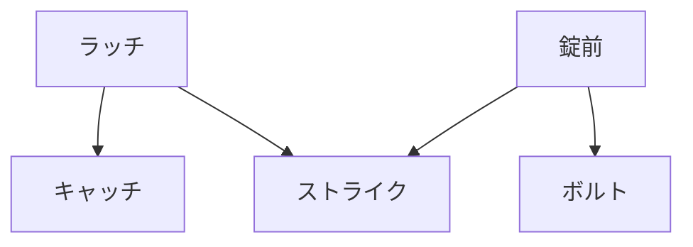

# Day 110: 誤解されやすい用語

ラッチと錠前は、産業用機構部品の中でよく使われる重要な要素ですが、用語の使い方が誤解されやすいことがあります。特に異業種から転職してきた方にとっては、これらの用語が混同されがちです。今日は、ラッチと錠前の基本的な違いと、誤解されやすい用語について解説します。

## ラッチと錠前の違い

まず、ラッチは扉や蓋を一時的に固定するための装置であり、通常は簡単に解除できるようになっています。例えば、冷蔵庫のドアを閉じたときに「カチッ」と音がするのはラッチの働きです。ラッチは、保持力が強くないため、通常は安全性よりも利便性を重視した設計になっています。

一方、錠前はセキュリティを目的とした装置で、鍵やダイヤルなどで施錠・解錠を行います。錠前は、ラッチと異なり、意図的な解除がない限り開かないように設計されています。これにより、物理的な防犯効果を提供します。

## 誤解されやすい用語

1. **キャッチ**: ラッチと似た役割を持つ部品ですが、キャッチは通常、扉が閉じた状態を保持するための部品を指します。ラッチが「固定」するのに対し、キャッチは「保持」するというニュアンスがあります。

2. **ボルト**: 錠前の一部として使われることが多い用語です。ボルトは、施錠時に扉や蓋をしっかりと固定するためにスライドする部品です。ラッチにも使われることがありますが、錠前のボルトはより頑丈で、セキュリティを重視しています。

3. **ストライク**: ラッチや錠前の受け側の部品を指します。ストライクは、ラッチやボルトがはまる部分で、これによって扉がしっかりと閉じられます。ストライクの形状や材質は、ラッチや錠前の種類によって異なります。

## 図で理解する

## 今日のポイント
- ラッチは一時的な固定、錠前はセキュリティ目的
- キャッチは保持、ボルトは固定の役割
- ストライクはラッチや錠前の受け側

## 明日へのつながり
次回は、ラッチと錠前の具体的な選定基準について学びます。用途に応じた適切な選び方を理解しましょう。
