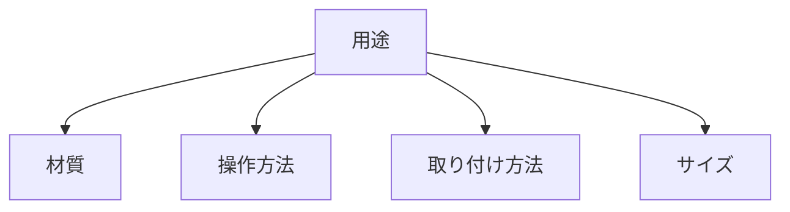

# Day 111: ラッチ選定チェックリスト

ラッチや錠前は、扉や蓋を固定するための重要な部品です。異業種から転職した方にとって、これらの部品を選定する際に何を基準にすれば良いかは分かりにくいかもしれません。今日は、図面が読めなくてもラッチを選ぶ際の基本的なチェックリストを学びます。

## ラッチ選定の基本

ラッチを選ぶ際には、以下のポイントを考慮します。

1. **用途**: どのような場面で使用するかを明確にします。例えば、家庭用家具の扉なのか、産業用機械のカバーなのかで求められる性能が異なります。

2. **材質**: 使用環境によって適した材質を選びます。屋外で使用する場合は耐候性のあるステンレスやプラスチックが適しています。

3. **操作方法**: 手で簡単に操作できるものから、工具を使わないと開けられないものまで様々です。安全性や操作性を考慮して選びましょう。

4. **取り付け方法**: 取り付ける場所の構造を考慮し、適切な取り付け方法を選びます。ネジ止めや溶接などがあります。

5. **サイズ**: 扉や蓋の大きさ、重さに応じたサイズのラッチを選びます。小さいものでは固定力が不足することがあります。

これらのポイントを踏まえて、具体的な製品を選定します。選定の際には、タキゲンやシブタニ、栃木屋、スガツネといったメーカーの製品を参考にすると良いでしょう。

## 図で理解する

## 今日のポイント
- ラッチ選定は用途と環境を考慮
- 操作方法と取り付け方法も重要
- サイズは固定力に影響

## 明日へのつながり
明日は、ラッチの具体的な取り付け方法について詳しく学び、実際の現場での応用力を高めます。
