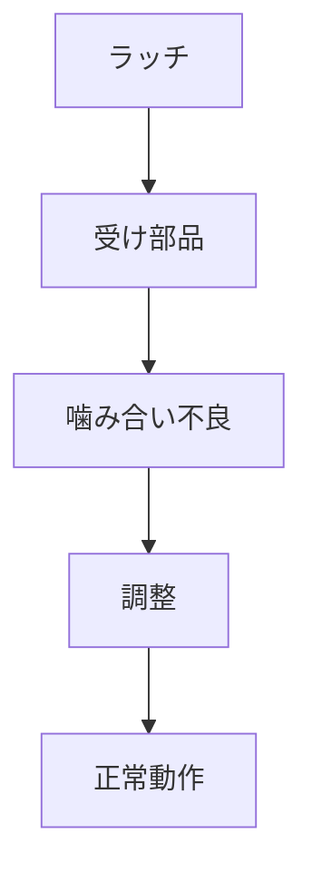

# Day 112: 現場トラブル例

ラッチや錠前は、扉や蓋を確実に閉じるための重要な部品です。しかし、現場ではこれらの部品に関連するトラブルが発生することがあります。今回は、図面が読めなくても理解できるように、一般的なトラブル例とその原因、解決策について説明します。

## よくあるトラブル例

### 1. ラッチが閉まらない

**原因:**  
ラッチが閉まらない原因の一つは、取り付け位置のずれです。ラッチと受け部品が正しく噛み合っていないと、しっかりと閉まらないことがあります。また、ラッチ自体が摩耗している場合もあります。

**解決策:**  
取り付け位置を再調整し、ラッチと受け部品がしっかりと噛み合うようにします。摩耗が原因の場合は、新しいラッチに交換することを検討します。

### 2. 錠前が開かない

**原因:**  
錠前が開かない場合、鍵の変形や内部の機構が故障している可能性があります。特に、頻繁な使用による摩耗や、鍵穴に異物が詰まっていることが原因となることがあります。

**解決策:**  
まず、鍵の状態を確認し、変形がある場合は修正または交換します。内部機構の故障が疑われる場合は、専門業者に修理を依頼するのが安全です。

### 3. ラッチが緩む

**原因:**  
ラッチが緩む原因は、取り付けネジの緩みや、使用中の振動によるものです。これにより、ラッチの固定が不安定になり、正常に機能しなくなります。

**解決策:**  
定期的にネジの締め直しを行い、振動が多い環境では振動対策を講じます。必要に応じて、ネジに緩み止め剤を使用することも有効です。

## 図で理解する

## 今日のポイント
- ラッチの噛み合い不良は位置調整で解決
- 錠前の故障は鍵の変形や内部機構が原因
- 定期的なネジの締め直しで緩みを防止

## 明日へのつながり
明日は、ラッチや錠前のメンテナンス方法について学び、トラブルを未然に防ぐための知識を深めましょう。
