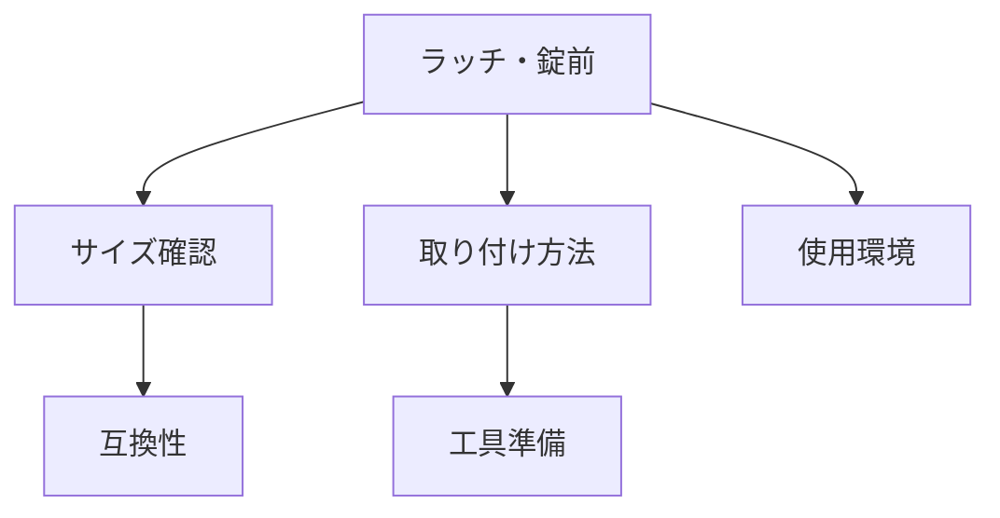

# Day 113: 交換時の注意

ラッチや錠前は、ドアやキャビネットなどの開閉を制御するための重要な部品です。これらの部品を交換する際には、いくつかの注意点を理解しておくことが重要です。図面が読めなくても、基本的な仕組みと注意点を押さえておけば、交換作業をスムーズに進められます。

## 1. サイズと互換性の確認

まず、交換するラッチや錠前のサイズを確認しましょう。サイズが合わないと、正しく取り付けられず、機能しないことがあります。一般的に、取り付け穴の間隔や本体の厚みが重要です。既存の部品と同じサイズのものを選ぶか、調整可能な部品を選ぶと良いでしょう。

## 2. 取り付け方法の理解

ラッチや錠前の取り付け方法は、各メーカーや製品によって異なります。取り付けネジの位置や数、必要な工具を確認し、事前に準備しておくことが大切です。取り付けが不十分だと、部品が緩んでしまい、正常に機能しないことがあります。

## 3. 使用環境の考慮

使用する環境によって、選ぶべきラッチや錠前の種類が変わります。例えば、屋外で使用する場合は、耐候性や防錆性が求められます。また、頻繁に開閉する場所では、耐久性の高い製品を選ぶことが重要です。使用環境に適した製品を選ぶことで、長期にわたって安定した性能を発揮します。

## 図で理解する

## 今日のポイント
- サイズと互換性を確認する
- 取り付け方法を理解する
- 使用環境に適した製品を選ぶ

## 明日へのつながり
明日は、ラッチや錠前のメンテナンス方法について学び、長持ちさせるためのポイントを詳しく見ていきます。
