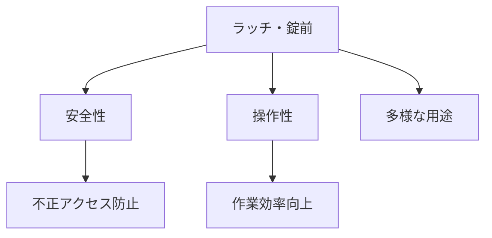

# Day 114: 4社カテゴリの共通点

ラッチと錠前は、産業用機器や設備の安全性と操作性を確保するために欠かせない部品です。今回は、タキゲン、シブタニ（APPIT）、栃木屋、スガツネの4社の製品カテゴリに共通する特徴を見ていきましょう。これらの共通点を理解することで、図面が読めなくても、どのように製品が選定され、使用されるかをイメージしやすくなります。

## 共通点1: 安全性の確保

ラッチと錠前は、機器や設備の扉やカバーを確実に固定する役割があります。これにより、機器内部への不正アクセスを防ぎ、作業者の安全を確保します。各社の製品は、堅牢な構造と耐久性を持ち、長期間にわたって安定した性能を発揮します。

## 共通点2: 操作性の向上

これらの部品は、操作性を向上させるために設計されています。例えば、片手で簡単に開閉できるものや、特定の工具を使用してのみ解除できるものなど、用途に合わせた多様な操作方法が提供されています。これにより、作業効率が向上し、誤操作を防ぐことができます。

## 共通点3: 多様な用途への対応

4社の製品は、さまざまな産業分野で使用されています。例えば、製造業の機械カバー、輸送機器のドア、電気設備のパネルなど、用途に応じた製品がラインナップされています。これにより、特定のニーズに応じた最適な製品を選定することが可能です。

## 図で理解する

## 今日のポイント
- ラッチと錠前は安全性を高める
- 操作性の向上で作業効率アップ
- 多様な用途に対応する製品

## 明日へのつながり
明日は、ラッチと錠前の具体的な選定基準について掘り下げます。適切な選定がどのように機器の性能を左右するかを学びましょう。
