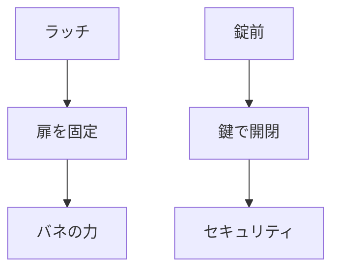

# Day 115: 図なしで説明する練習

今日のテーマは、ラッチと錠前の仕組みを図なしで説明する練習です。図面が読めない方でも、これらの部品の役割や動きを理解できるように言葉で解説します。

## ラッチの基本

ラッチは、扉や蓋を閉じた状態で保持するための部品です。ラッチの基本的な動きは、バネの力を利用して、扉を閉じた際に自動的に固定することです。これにより、扉が意図せず開くのを防ぎます。ラッチは、押すと開くタイプや、引っ張ると開くタイプなど、操作方法が異なるものがあります。

### ラッチの役割

- **保持機能**: 扉や蓋を閉じた状態で固定する。
- **簡易操作**: 片手で操作できるものが多く、利便性が高い。
- **安全性向上**: 不意の開放を防ぎ、内部の安全を確保する。

## 錠前の基本

錠前は、ラッチと同様に扉を固定する役割を持ちますが、鍵を使用して開閉を制御する点が異なります。錠前は、鍵を差し込んで回すことで内部の機構が動き、扉を開けたり閉めたりすることができます。これにより、セキュリティを確保することが可能です。

### 錠前の役割

- **セキュリティ**: 鍵によって開閉を制御し、許可された人だけがアクセスできるようにする。
- **耐久性**: 頑丈な構造で、長期間使用に耐える。
- **多様性**: 鍵の形状や操作方法が多種多様で、用途に応じた選択が可能。

## 図で理解する

## 今日のポイント
- ラッチはバネで扉を固定
- 錠前は鍵で開閉を制御
- 両者とも安全性を向上

## 明日へのつながり
明日は、ラッチと錠前の具体的な選定基準について学びます。用途に応じた適切な部品選びのポイントを押さえましょう。
