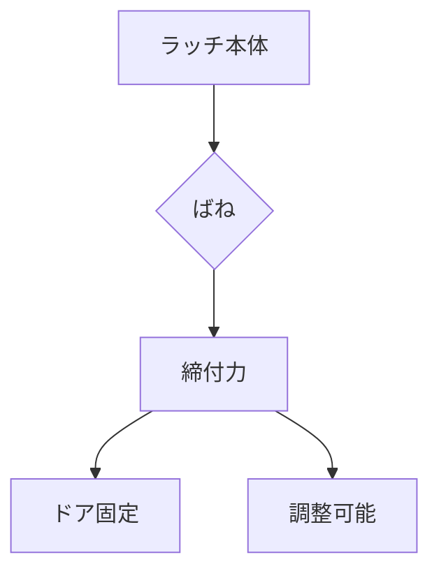

# Day 116: 締付力の読み方

ラッチや錠前は、ドアやパネルをしっかりと固定するために使われる部品です。これらの部品が正しく機能するためには、「締付力」が重要な役割を果たします。締付力とは、ラッチや錠前が物を押さえつける力のことです。今日は、この締付力についての基本的な仕組みを学びましょう。

## 締付力の基本

締付力は、ラッチや錠前が動かないようにするための力です。この力が弱いと、ドアが不意に開いてしまうことがあります。逆に強すぎると、開閉が難しくなり、部品や取り付け面に負担がかかります。適切な締付力を選ぶことが、機能性と安全性を両立させる鍵となります。

## 締付力の調整方法

締付力は、以下の方法で調整することができます。

1. **ばねの強さを調整する**: 多くのラッチや錠前はばねを使って締付力を生み出しています。ばねの強さを変えることで、締付力を調整できます。

2. **取り付け位置の調整**: ラッチや錠前の取り付け位置を微調整することで、締付力を変えることができます。特に、ラッチの受け側の位置を調整することが効果的です。

3. **部品の交換**: 締付力が調整できない場合や、調整範囲を超えている場合は、適切な締付力を持つ別の部品に交換することも検討します。

## 図で理解する

以下の図は、ラッチの締付力の基本的な仕組みを示しています。

## 今日のポイント
- 締付力は物を固定する力
- ばねや取り付け位置で調整可能
- 適切な力が安全性を確保

## 明日へのつながり
明日は、締付力が異なる状況でどのように選定するかを学びます。これにより、より具体的な選定スキルを身につけましょう。
