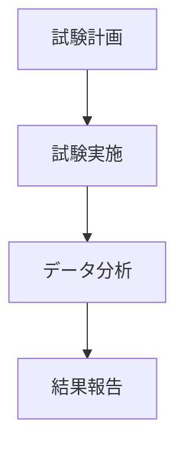

# Day 117: 試験・検証の基礎

ラッチや錠前は、扉や蓋をしっかりと固定するための重要な部品です。この部品が正常に機能するかどうかを確認するためには、試験と検証が欠かせません。今日は、その基本的なプロセスについて学びましょう。

## 試験の目的

ラッチや錠前の試験は、製品が設計通りに機能し、耐久性や安全性が確保されているかを確認するために行われます。具体的には、以下のような点を確認します。

- **動作確認**: 正常に開閉できるか
- **耐久性**: 長期間使用しても壊れないか
- **安全性**: 使用時に危険がないか

これらの確認により、製品の信頼性を高めることができます。

## 検証のプロセス

検証は、試験の結果を基に製品が基準を満たしているかを判断するプロセスです。一般的な検証の流れは以下の通りです。

1. **試験計画の策定**: 何をどのように試験するかを決めます。
2. **試験の実施**: 実際に試験を行い、データを収集します。
3. **データの分析**: 試験結果を分析し、基準に適合しているかを確認します。
4. **結果の報告**: 検証結果をまとめ、関係者に報告します。

このプロセスを通じて、製品の品質を保証することができます。

## 図で理解する

## 今日のポイント
- 試験は製品の信頼性を確認するために必須
- 検証プロセスは計画、実施、分析、報告から成る
- 試験結果を基に製品の品質を保証

## 明日へのつながり
明日は、試験・検証で得られたデータをどのように活用するか、具体的な事例を通じて学びます。
