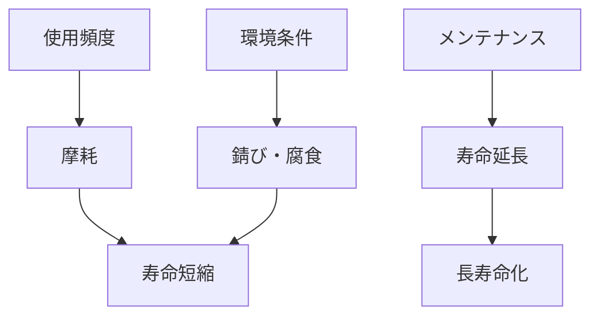

# Day 118: 錠前の寿命

錠前は、ドアやキャビネットなどの開閉を制御する重要な部品です。その寿命は、使用頻度や環境条件に大きく影響されます。今回は、図面が読めなくても理解できる錠前の寿命についての基本的な仕組みを学びます。

## 錠前の寿命に影響する要因

1. **使用頻度**: 錠前は、開閉のたびに摩耗します。頻繁に使用される錠前は、摩耗が早く進むため、寿命が短くなる傾向があります。

2. **環境条件**: 錠前が設置されている環境も寿命に影響します。例えば、湿気の多い場所や塩害のある地域では、錆びや腐食が進みやすく、錠前の寿命を縮める原因となります。

3. **メンテナンス**: 定期的なメンテナンスは、錠前の寿命を延ばすために重要です。潤滑油の塗布や、汚れの除去などの簡単な手入れを行うことで、動作がスムーズになり、寿命が延びます。

## 錠前の寿命を延ばすためのポイント

- **適切な選定**: 使用環境に適した素材や設計の錠前を選ぶことが重要です。例えば、屋外で使用する場合は、耐候性のある素材を選ぶと良いでしょう。

- **定期的な点検**: 錠前がスムーズに動作しているか、異常な摩耗や錆びがないかを定期的に確認します。異常が見つかった場合は、早めに対処することが大切です。

- **潤滑と清掃**: 錠前の可動部分に適切な潤滑を行い、汚れや埃を取り除くことで、摩耗を減らし、動作不良を防ぎます。

## 図で理解する

## 今日のポイント
- 錠前の寿命は使用頻度で変わる
- 環境条件が錠前の劣化に影響
- 定期的なメンテナンスが長寿命化の鍵

## 明日へのつながり
明日は、錠前の具体的なメンテナンス方法について詳しく学びます。日常的にできる手入れ方法を知り、錠前を長持ちさせましょう。
