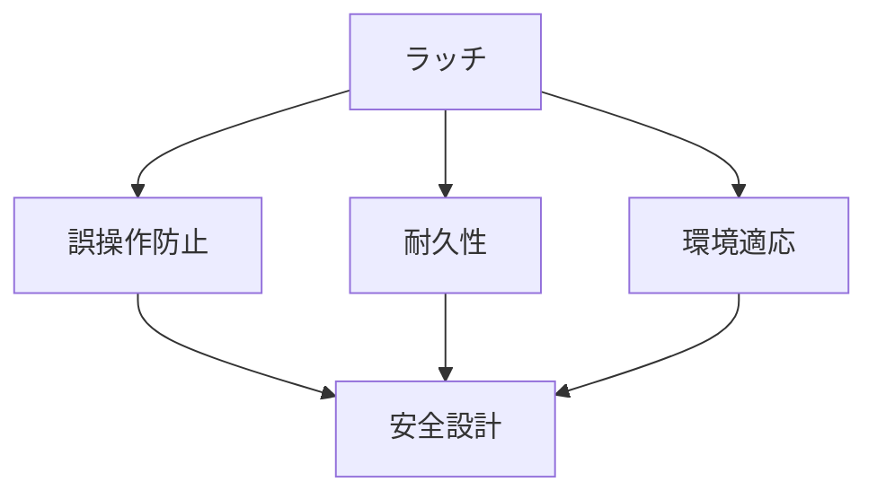

# Day 119: 安全設計

ラッチや錠前は、ドアやキャビネットの開閉を制御するための重要な部品です。これらの部品の安全設計は、使用者の安全を確保するために不可欠です。今回は、図面が読めなくても理解できるように、ラッチ・錠前の安全設計の基本的な仕組みを解説します。

## ラッチ・錠前の基本構造

ラッチは、ドアや蓋が閉じた状態を維持するための部品で、通常はばねの力を利用して自動的に閉じる機構を持っています。一方、錠前は鍵を使って開閉を制御する部品で、より高いセキュリティを提供します。どちらも、誤操作や不意の開放を防ぐための安全設計が施されています。

## 安全設計の要素

1. **誤操作防止機構**  
   誤って開けてしまうことを防ぐために、ラッチや錠前には誤操作防止機構が組み込まれています。例えば、二重の操作が必要なデザインや、特定の方向にしか動かない仕組みが用いられます。

2. **耐久性の向上**  
   長期間の使用に耐えるため、ラッチや錠前は耐久性の高い材料で作られています。これにより、経年劣化による不意の故障を防ぎます。

3. **使用環境への適応**  
   使用する環境に応じて、耐腐食性や耐熱性などの特性を持たせることも重要です。これにより、過酷な環境でも安全に使用できます。

## 図で理解する

## 今日のポイント
- ラッチ・錠前は誤操作防止機構を持つ
- 耐久性の高い材料で安全性を確保
- 使用環境に応じた特性が重要

## 明日へのつながり
明日は、ラッチ・錠前の「メンテナンス方法」について学びます。安全設計を活かすための保守の重要性を理解しましょう。
