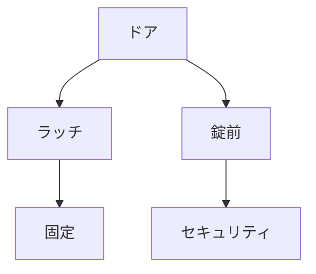

# Day 120: ラッチ・錠前カテゴリまとめ

ラッチと錠前は、ドアやカバーを固定するための重要な機構部品です。これらは、セキュリティや安全性を確保するために広く使われています。今日は、これらの部品の基本的な仕組みと役割を理解し、図面が読めなくてもその動きをイメージできるようにしましょう。

## ラッチの仕組みと役割

ラッチは、ドアやカバーを閉じた状態で固定するための部品です。一般的には、ドアを押したり引いたりすることで簡単に開閉できるように設計されています。ラッチの主な役割は以下の通りです：

1. **固定**：ドアやカバーを閉じた状態で保持します。
2. **簡単操作**：手軽に開閉できるため、頻繁に使用される場所に適しています。
3. **安全性**：不意に開かないようにすることで、内容物の保護や安全性を確保します。

## 錠前の仕組みと役割

錠前は、鍵を使って開閉することで、より高いセキュリティを提供する部品です。錠前は以下のような特徴を持っています：

1. **セキュリティ**：鍵を使わないと開かないため、貴重品や機密情報の保護に最適です。
2. **耐久性**：頑丈な構造で、長期間の使用に耐えます。
3. **多様性**：さまざまな形状や機能があり、用途に応じて選べます。

## ラッチと錠前の違い

ラッチと錠前は似たような役割を持っていますが、使用目的や操作方法に違いがあります。ラッチは、頻繁に開閉する場所での利便性を重視し、錠前はセキュリティを重視します。用途に応じて、これらを適切に選択することが重要です。

## 図で理解する

## 今日のポイント
- ラッチは簡単に開閉できる固定具
- 錠前は鍵で開閉し高いセキュリティを提供
- 用途に応じてラッチと錠前を選ぶ

## 明日へのつながり
明日は、ラッチと錠前の具体的な選び方について深掘りし、実際の現場での活用方法を学びます。
