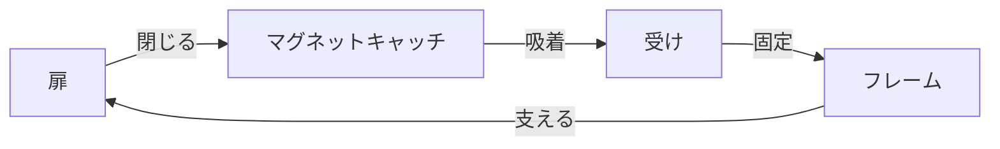

# Day 121: キャッチとは

キャッチは、主に扉や蓋を閉じた状態で保持するために使用される機構部品です。これにより、扉が意図せず開かないようにすることができます。キャッチには様々な種類がありますが、今回はその中でも特に一般的な「マグネットキャッチ」に焦点を当てて説明します。

## キャッチの基本的な仕組み

キャッチは、扉や蓋を閉じた際にそれを固定する役割を持っています。これにより、外部からの衝撃や振動で扉が勝手に開くのを防ぎます。キャッチは、通常、扉や蓋の内側に取り付けられ、相手側にはそれに対応する受けが取り付けられています。これにより、扉を閉じた際にしっかりと固定されます。

## マグネットキャッチの特徴

マグネットキャッチは、磁石の力を利用して扉や蓋を保持するタイプのキャッチです。磁石が持つ吸着力を利用するため、開閉がスムーズで、音も静かです。特に、軽い扉や蓋に適しており、家具やキャビネットなどでよく使用されています。

### マグネットキャッチの利点

1. **静音性**: 開閉時の音が非常に静かで、オフィスや家庭内での使用に適しています。
2. **メンテナンスフリー**: 機械的な摩耗が少なく、長期間にわたって安定した性能を発揮します。
3. **設置の容易さ**: 磁石と受けを取り付けるだけで機能するため、設置が簡単です。

## 図で理解する

## 今日のポイント
- キャッチは扉や蓋を固定する部品
- マグネットキャッチは磁石で固定
- 静音性と設置の容易さが特徴

## 明日へのつながり
明日は、キャッチの種類と用途についてさらに詳しく学びます。特に、異なる環境での使用例を見ていきましょう。
