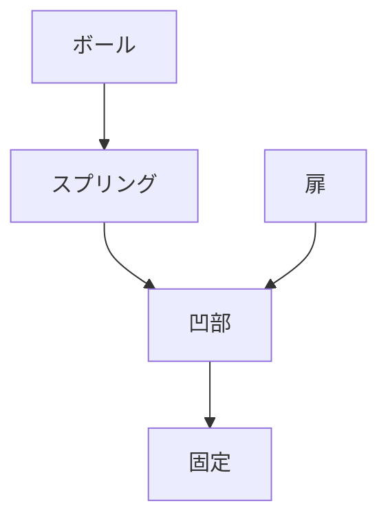

# Day 122: ボールキャッチの仕組み

ボールキャッチは、ドアや扉を閉じた状態で固定するための機構部品です。一般的に、ボールキャッチは家具やキャビネットの扉に使用され、扉がしっかりと閉まるようにサポートします。ボールキャッチの基本的な構造は、ボールとスプリングで構成されており、これらが連携して扉を固定します。

ボールキャッチの仕組みは、次のように機能します。まず、ボールはスプリングの力で常に押し出されている状態です。このボールが扉の受け側の凹部に入り込むことで、扉がしっかりと固定されます。扉を開ける際には、少し力を加えることでボールが凹部から外れ、スムーズに開閉が可能になります。

ボールキャッチの利点は、シンプルな構造でありながら、確実に扉を固定できることです。また、マグネットキャッチと異なり、金属製のボールとスプリングを使用しているため、磁石の影響を受けにくい環境でも使用できます。

ボールキャッチは、家庭用の家具だけでなく、オフィスや商業施設のキャビネット、棚などにも広く使用されています。特に、頻繁に開閉する扉には適しており、耐久性と信頼性が求められる場面で活躍します。

## 図で理解する

## 今日のポイント
- ボールキャッチはスプリングとボールで構成
- 扉を固定し、スムーズな開閉をサポート
- 磁石の影響を受けにくい

## 明日へのつながり
明日は、マグネットキャッチの仕組みを学び、ボールキャッチとの違いを理解します。
