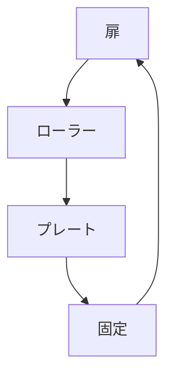

# Day 123: ローラーキャッチ

ローラーキャッチは、扉や引き出しをしっかりと閉じるための機構部品です。この部品は、主に家具やキャビネットのドアに使われ、扉が閉まった状態を保つ役割を果たします。ローラーキャッチの基本的な構造は、回転するローラーと、それを受け止めるプレートから成り立っています。

### ローラーキャッチの仕組み

ローラーキャッチは、名前の通り「ローラー」を使って動作します。ローラーは、ドアが閉じる際に回転しながらプレートに乗り上げ、最終的にプレートのくぼみに収まります。この動きにより、ドアは自然に閉じた状態を維持します。ローラーの回転により、ドアの開閉がスムーズになり、摩擦を減らすことで長期間使用しても劣化しにくいという利点があります。

### 使用例と利点

このキャッチは、家庭用の家具だけでなく、オフィスや公共施設のキャビネットにも広く使用されています。ローラーキャッチの利点は、以下の通りです。

1. **スムーズな動作**: ローラーが回転することで、扉の開閉が滑らかになります。
2. **耐久性**: 摩擦が少ないため、長期間の使用でも性能が落ちにくいです。
3. **簡単な取り付け**: 構造がシンプルで、取り付けが比較的容易です。

ローラーキャッチは、特に頻繁に開閉される扉に適しており、静かでスムーズな動作を求める環境に最適です。

## 図で理解する

## 今日のポイント
- ローラーが回転しスムーズに動作
- 摩擦が少なく耐久性が高い
- 取り付けが簡単で広く使用

## 明日へのつながり
明日は、キャッチの中でも特に強力な保持力を持つ「マグネットキャッチ」について学びます。ローラーキャッチとの違いを理解しましょう。
