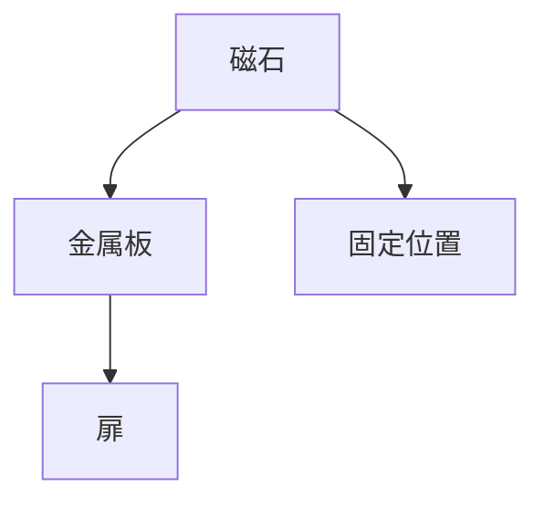

# Day 124: マグネットキャッチの仕組み

マグネットキャッチは、磁力を利用して扉や蓋を固定するための部品です。一般的には、家具やキャビネットの扉を閉じた状態で保持するために使われます。仕組みは非常にシンプルで、磁石と金属板が主な構成要素です。

### 仕組みの基本

マグネットキャッチは、通常、2つの主要な部分から成り立っています。一方は磁石、もう一方は金属板です。磁石は固定された位置に取り付けられ、金属板は動く部分、例えば扉や蓋の内側に取り付けられます。扉を閉じると、磁石が金属板を引き寄せ、しっかりと固定します。この固定力は、磁石の強さと金属板の材質に依存します。

### 特徴と利点

1. **簡単な取り付け**: マグネットキャッチは、取り付けが非常に簡単です。ドライバーとネジがあれば、誰でも取り付けることができます。
   
2. **メンテナンスフリー**: 機械的な部分が少ないため、メンテナンスがほとんど不要です。長期間にわたって安定した性能を発揮します。

3. **静音性**: 扉を閉じる際に音がほとんどしないため、静かな環境を保つことができます。

### 使用例

マグネットキャッチは、家庭用家具やオフィスのキャビネット、さらには自動車の内装部品など、さまざまな場面で使用されます。特に、頻繁に開閉する扉や蓋に適しています。

## 図で理解する

## 今日のポイント
- マグネットキャッチは磁力で固定
- 取り付けが簡単でメンテナンス不要
- 静音性が高く、家庭やオフィスで活躍

## 明日へのつながり

明日は、キャッチの中でも特に耐久性が求められる「ヘビーデューティキャッチ」について学びます。
