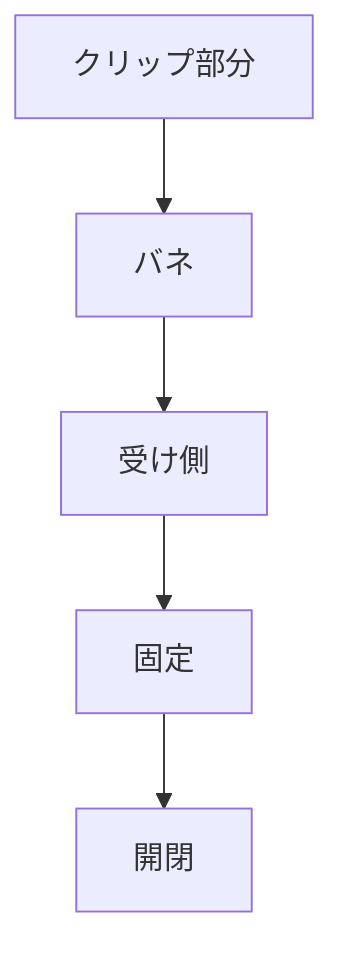

# Day 125: キャッチクリップ

キャッチクリップは、扉や蓋を固定するために使われる機構部品の一つです。キャッチとは、物をしっかりと保持するための仕組み全般を指しますが、キャッチクリップはその中でも特にバネを利用したものです。これにより、手軽に開閉できる一方で、しっかりと閉じた状態を保つことができます。

キャッチクリップの基本的な構造は、クリップ部分とそれを受ける受け側のパーツから成り立っています。クリップ部分はバネの力で閉じるようになっており、受け側のパーツにしっかりと挟み込むことで、扉や蓋を固定します。この仕組みは、例えば家具の扉や機械のカバーなど、頻繁に開閉する必要がある場所でよく使われます。

キャッチクリップの利点は、取り扱いが非常に簡単なことです。バネの力で自動的に閉じるため、片手で簡単に操作できます。また、特別な工具を必要とせずに取り付けられることが多く、メンテナンスも容易です。

一方で、キャッチクリップはバネの力に依存しているため、長期間使用するとバネが劣化し、保持力が低下することがあります。このため、定期的な点検や交換が必要です。また、クリップの素材や形状によっては、使用環境や用途に適さない場合もあるため、選定時には注意が必要です。

キャッチクリップは、シンプルな構造ながらも非常に便利な部品であり、さまざまな産業で広く利用されています。次回は、キャッチクリップの具体的な取り付け方や、選定時のポイントについて詳しく学んでいきましょう。

## 図で理解する

## 今日のポイント
- キャッチクリップはバネで固定
- 扉や蓋の開閉が簡単
- 定期的な点検が必要

## 明日へのつながり
明日は、キャッチクリップの取り付け方法や、選定時の注意点について詳しく学びます。
