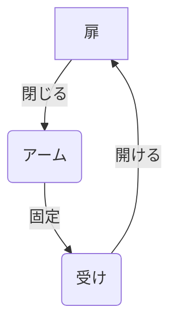

# Day 126: アームキャッチ

アームキャッチは、扉やパネルをしっかりと固定するための機構部品の一つです。特に、開閉が頻繁な場所や確実な固定が求められる場面で使用されます。今日は、図面が読めない方でも理解できるように、アームキャッチの仕組みとその役割について解説します。

## アームキャッチの仕組み

アームキャッチは、主に「アーム」と呼ばれる可動部分と、「受け」と呼ばれる固定部分から構成されています。このアームは、扉やパネルが閉じられるときに受けに引っかかり、しっかりと固定されるのが特徴です。アームの動きはスムーズで、開閉時の抵抗が少ないため、軽い力で操作できます。

### アームの動き

アームキャッチのアームは、通常バネの力で一定の位置に戻るように設計されています。扉を閉じるとアームが受けに押し込まれ、バネの力でしっかりと固定されます。開ける際には、アームを押し戻すことで固定が解除され、扉を開くことができます。

### 役割と用途

アームキャッチは、主に以下のような場面で使用されます。

1. **安全性の確保**: 扉やパネルが不意に開くのを防ぎ、安全性を高めます。
2. **振動対策**: 振動が多い環境でも、しっかりと固定されるため、機器の安定性を保ちます。
3. **簡単な操作性**: 軽い力で開閉できるため、頻繁に使用する場所に最適です。

## 図で理解する

## 今日のポイント
- アームキャッチは扉を確実に固定する
- バネの力でアームが自動的に戻る
- 振動対策や安全性向上に有効

## 明日へのつながり
明日は、アームキャッチの設置方法と注意点について詳しく学びます。正しい設置が性能を最大限に引き出します。
