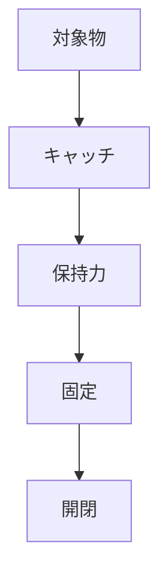

# Day 127: 保持力の考え方

キャッチやマグネットキャッチは、扉や蓋をしっかりと固定するために使用される部品です。これらの部品の「保持力」とは、どの程度の力で対象物を固定できるかを示す重要な要素です。保持力が適切でないと、扉が意図せず開いてしまったり、逆に開けるのが困難になったりすることがあります。

## 保持力とは？

保持力は、キャッチやマグネットキャッチが対象物をどれだけ強く保持できるかを示す力のことです。これは通常、ニュートン（N）やキログラムフォース（kgf）といった単位で表されます。保持力が大きいほど、対象物をしっかりと固定することができますが、開閉時に必要な力も大きくなります。

## 保持力の調整

保持力は、使用する素材や設計によって調整可能です。たとえば、マグネットキャッチの場合、磁石の強度を変えることで保持力を調整できます。また、キャッチの形状や取り付け位置を工夫することで、必要な保持力を得ることができます。

## 使用場面での考慮点

保持力を選ぶ際には、使用する場面を考慮することが重要です。例えば、頻繁に開閉する扉には適度な保持力が必要ですが、あまり開け閉めしない場所には強い保持力が有効です。また、使用する環境（湿気や温度）によっても保持力が変化することがあるため、適切な素材選びも重要です。

## 図で理解する

## 今日のポイント
- 保持力は固定力の指標
- 調整可能な設計が重要
- 使用環境で保持力が変化

## 明日へのつながり
明日は、保持力を考慮したキャッチの選び方について詳しく学びます。適切な選択が長期的な使用にどのように影響するかを探ります。
