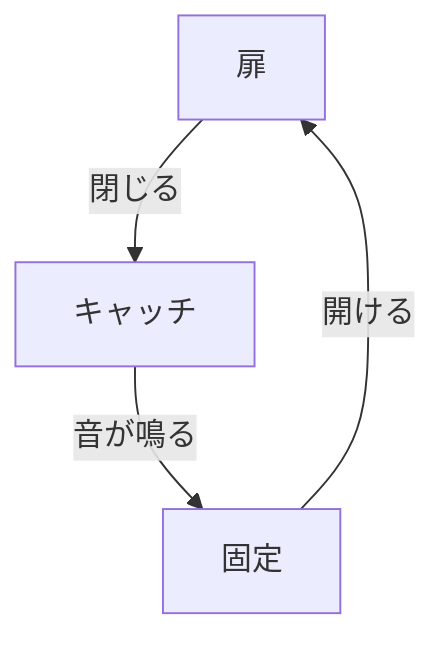

# Day 128: 扉の閉じ音とキャッチ

キャッチやマグネットキャッチは、扉や引き出しが閉まるときの「カチッ」という音を生み出す部品です。この音は単なる音ではなく、扉がしっかりと閉じられたことを確認するための重要な要素です。今日は、キャッチやマグネットキャッチがどのようにして扉の閉じ音を和らげ、固定する役割を果たしているのかを学びます。

まず、キャッチとは、扉が閉じたときにその位置を固定するための部品です。キャッチにはバネやマグネットが使われることが多く、これが扉の閉じ音を生み出します。バネを使ったキャッチは、扉が閉じるときにバネの力でしっかりと固定されるため、「カチッ」という音がします。一方、マグネットキャッチは磁石の力で扉を固定しますが、こちらも同様に音が発生します。

扉の閉じ音は、ユーザーにとって重要なフィードバックです。音がしっかりと聞こえることで、扉が確実に閉じたことを確認できます。また、音の大きさや質感は、製品の品質感にも影響を与えます。例えば、高級家具では、静かで落ち着いた音が好まれることがあります。

キャッチやマグネットキャッチの選択は、扉の材質や使用環境によって異なります。金属製の扉には強力なマグネットキャッチが適している場合がありますし、木製の扉にはバネ式のキャッチが使われることが多いです。これらの選択により、扉の閉じ音や固定力が変わってきます。

## 図で理解する

## 今日のポイント
- キャッチは扉を固定し、閉じ音を生む
- バネとマグネットが主な仕組み
- 音質が製品の印象を左右する

## 明日へのつながり
明日は、キャッチとマグネットキャッチの選び方について詳しく学びます。どのような環境でどのタイプが適しているのかを見ていきましょう。
