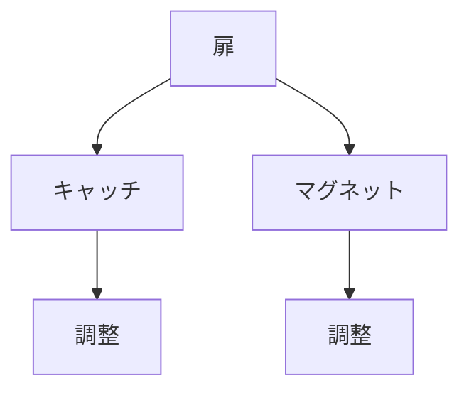

# Day 129: 調整方法

キャッチやマグネットキャッチは、扉や蓋をしっかりと閉じるために使われる重要な部品です。これらの部品は、適切に調整されていないと、扉がうまく閉まらなかったり、逆に開かなくなったりすることがあります。今日は、図面が読めなくても理解できるように、キャッチやマグネットキャッチの調整方法について学びましょう。

## キャッチの調整

キャッチは、扉や蓋を閉じたときにしっかりと固定するための部品です。調整が必要な理由としては、取り付け位置のズレや、使用による摩耗などがあります。キャッチの調整は、以下の手順で行います。

1. **位置の確認**: 扉を閉じた状態で、キャッチがしっかりと噛み合っているか確認します。ズレている場合は、取り付け位置を微調整します。

2. **締め付け具合の調整**: キャッチの締め付け具合を調整することで、扉の開閉のしやすさを変えることができます。ネジを緩めたり締めたりして、適切な力で閉まるように調整します。

3. **動作確認**: 調整後、扉を何度か開閉して、スムーズに動くか確認します。必要に応じて再度調整を行います。

## マグネットキャッチの調整

マグネットキャッチは、磁力を利用して扉を閉じる仕組みです。調整が必要な場合は、以下の手順で行います。

1. **磁力の確認**: 扉を閉じたときに、マグネットがしっかりと吸着しているか確認します。吸着が弱い場合は、マグネットの位置を調整します。

2. **位置調整**: マグネットと受け金具の位置がずれていると、吸着力が弱くなります。位置を微調整して、最適な吸着状態を作ります。

3. **吸着力の調整**: 一部のマグネットキャッチは、吸着力を調整できるタイプもあります。説明書に従って、適切な吸着力に調整します。

## 図で理解する

## 今日のポイント
- キャッチの位置と締め付け具合を調整
- マグネットの位置と吸着力を調整
- 調整後は動作確認を行う

## 明日へのつながり
明日は、キャッチやマグネットキャッチの材質とその選び方について学びます。適切な材質を選ぶことで、より長く使用できる製品を作ることができます。
