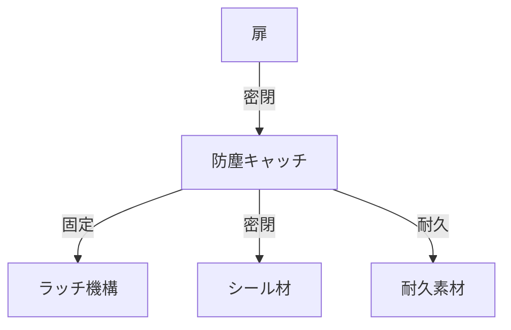

# Day 130: 防塵キャッチ

防塵キャッチは、機械の扉やカバーを閉じた際に、埃や汚れが内部に侵入するのを防ぐための部品です。この部品は、特に工場や製造現場で重要な役割を果たします。防塵キャッチの主な目的は、機械の内部を清潔に保ち、故障を防ぐことです。

## 防塵キャッチの仕組み

防塵キャッチは、通常のキャッチやマグネットキャッチと同様に、扉をしっかりと閉じる役割を持ちますが、特に密閉性が高く設計されています。これにより、埃や汚れが隙間から侵入するのを防ぎます。

### 主な構成要素

1. **ラッチ機構**: 扉をしっかりと固定するための部分です。ラッチとは、扉を閉じた際にカチッと固定する機構のことです。
2. **シール材**: ゴムやシリコンなどの弾力性のある素材で、扉とフレームの間を密閉します。これにより、埃や汚れの侵入を防ぎます。
3. **耐久性のある素材**: 防塵キャッチは、耐久性のある金属やプラスチックで作られており、長期間の使用に耐えます。

## 使用される場所

防塵キャッチは、特に以下のような場所で使用されます。

- **工場の機械**: 機械内部の部品を埃や汚れから守ります。
- **食品加工設備**: 清潔さが求められる環境で、外部からの汚染を防ぎます。
- **屋外設備**: 雨や風による汚れの侵入を防ぎます。

## 図で理解する

## 今日のポイント
- 防塵キャッチは埃や汚れを防ぐ
- ラッチ機構で扉をしっかり固定
- シール材で密閉性を高める

## 明日へのつながり

明日は、防塵キャッチの取り付け方法とメンテナンスについて学びます。これにより、長期間にわたって効果的に使用する方法を理解します。
