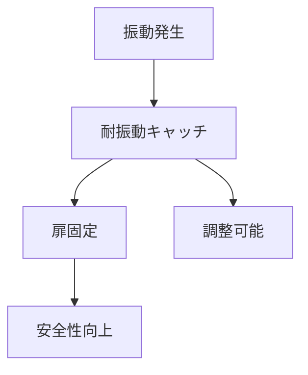

# Day 131: 耐振動キャッチ

耐振動キャッチは、振動が発生する環境下で扉やパネルをしっかりと固定するための機構部品です。特に産業用設備や輸送機器など、振動が避けられない状況で活躍します。通常のキャッチでは振動によって扉が開いてしまう恐れがありますが、耐振動キャッチはその名の通り、振動に対して強い耐性を持っています。

## 耐振動キャッチの仕組み

耐振動キャッチは、主に以下の要素で構成されています：

1. **ロック機構**: 振動による影響を受けにくいよう、しっかりと扉を固定するための仕組みです。これには、スプリングやラッチなどが用いられます。
2. **調整可能な締め付け力**: 扉の開閉頻度や使用環境に応じて、締め付け力を調整できるようになっています。これにより、過度な摩耗や故障を防ぎます。
3. **耐久性のある素材**: 振動による摩耗を最小限に抑えるため、耐久性の高い素材が使用されています。例えば、ステンレスや特殊合金などが一般的です。

## 使用例

耐振動キャッチは、以下のような場面で使用されます：

- **輸送機器**: 電車やバスなど、常に振動がある環境での使用が想定されています。
- **産業用機械**: 工場内での振動を伴う機械に取り付けられ、機械の安全性を高めます。
- **建設機器**: 建設現場での振動を受ける機器に使用され、作業効率を向上させます。

## 図で理解する

## 今日のポイント
- 耐振動キャッチは振動環境での固定に優れる
- 調整可能な締め付け力で適応性が高い
- 耐久性のある素材で長寿命を実現

## 明日へのつながり
明日は、耐振動キャッチの具体的な調整方法やメンテナンスについて学びます。これにより、長期間にわたって安全に使用するための知識を深めましょう。
