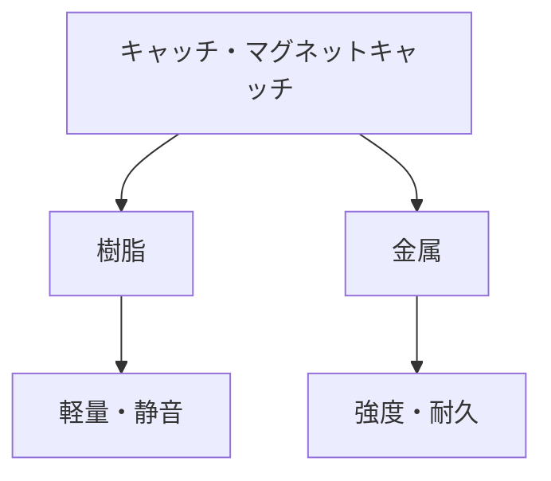

# Day 132: 樹脂と金属の違い

キャッチやマグネットキャッチは、扉や蓋を確実に閉じるための部品です。これらの部品は、使用される素材によって特性が異なります。今回は、樹脂と金属のキャッチ・マグネットキャッチの違いについて学びます。

## 樹脂のキャッチ

樹脂製のキャッチは、軽量で耐腐食性に優れています。これにより、湿気の多い環境や化学薬品を扱う場所での使用に適しています。また、樹脂は柔軟性があるため、衝撃を吸収しやすく、静音性も高いです。例えば、家庭用の家具や家電製品のドアに使用されることが多いです。

### 樹脂の特徴
- **軽量性**: 扉や蓋に負担をかけにくい
- **耐腐食性**: 湿気や化学薬品に強い
- **静音性**: 開閉時の音が静か

## 金属のキャッチ

一方、金属製のキャッチは、強度と耐久性に優れています。これにより、重い扉や高頻度で開閉する場所に適しています。また、金属は高温環境にも耐えられるため、工場や屋外での使用に向いています。ただし、腐食のリスクがあるため、環境に応じた適切な選択が必要です。

### 金属の特徴
- **強度**: 重い扉や高頻度の使用に適する
- **耐久性**: 長期間の使用に耐える
- **高温耐性**: 工場や屋外での使用に適する

## 図で理解する

## 今日のポイント
- 樹脂は軽量で耐腐食性が高い
- 金属は強度と耐久性に優れる
- 使用環境に応じた素材選択が重要

## 明日へのつながり

明日は、キャッチ・マグネットキャッチの取り付け方法について学びます。適切な取り付けにより、性能を最大限に引き出す方法を理解しましょう。
