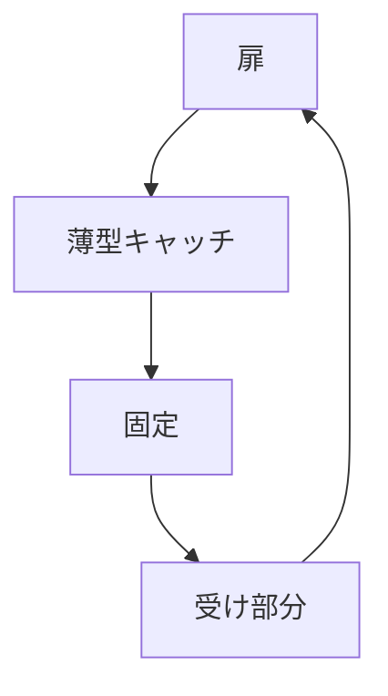

# Day 133: 薄型キャッチ

薄型キャッチは、限られたスペースで使用できるキャッチ機構です。通常のキャッチよりも厚みが少ないため、狭い場所や見た目をスッキリさせたい場所に最適です。たとえば、家具の扉や収納の蓋などに使用され、開閉時の固定を確実に行います。

## 薄型キャッチの仕組み

薄型キャッチは、主に金属や樹脂で作られた小さな部品で、扉や蓋を開けた状態から閉じた状態にする際に、しっかりと固定する役割を果たします。キャッチ部分と受け部分があり、閉じるときにこれらが噛み合うことで固定されます。マグネットを使用したタイプもあり、よりスムーズな開閉が可能です。

## 使用のメリット

1. **省スペース設計**: 薄型であるため、狭いスペースでも邪魔にならず、見た目もスッキリします。
2. **取り付けが容易**: 小型で軽量なため、取り付けが簡単で、特別な工具を必要としません。
3. **多様な用途**: 家具や収納、電化製品の扉など、様々な場所で使用可能です。

## 図で理解する

## 今日のポイント
- 薄型キャッチは狭いスペースに最適
- マグネットタイプでスムーズな開閉
- 家具や収納に多用途で活用

## 明日へのつながり
次回は、薄型キャッチの取り付け方法と注意点について詳しく学びます。
