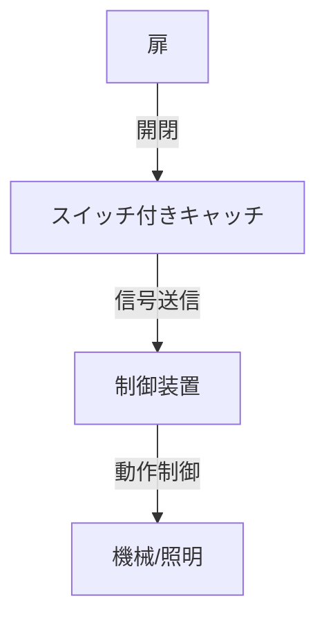

# Day 134: スイッチ付きキャッチ

スイッチ付きキャッチは、扉やフタの開閉状態を検知するための機能を持つキャッチです。この機構は、特に安全性や利便性が求められる場面で使用されます。例えば、機械のカバーが開いているときに機械を動作させないようにする安全機構や、扉が開いたときに自動で照明を点灯させるといった用途があります。

## スイッチ付きキャッチの仕組み

スイッチ付きキャッチの基本的な構造は、通常のキャッチにスイッチ機能が追加されたものです。キャッチ部分が扉やフタをしっかりと固定し、開閉時にスイッチがオン・オフすることで、電気信号を送ります。この信号を利用して、様々な機能を実現します。

### 使用例

1. **安全装置**: 機械のカバーが開いているときにスイッチがオフになり、機械の動作を停止させる。
2. **自動照明**: 扉が開くとスイッチがオンになり、内部の照明が自動で点灯する。
3. **警報装置**: 扉が不正に開かれた場合に警報を鳴らす。

## 図で理解する

## 今日のポイント
- スイッチ付きキャッチは開閉状態を検知
- 安全性や利便性を向上させる
- 機械制御や自動化に利用

## 明日へのつながり
明日は、スイッチ付きキャッチの具体的な応用例をさらに深掘りし、どのようにして産業現場で活用されているかを学びます。
