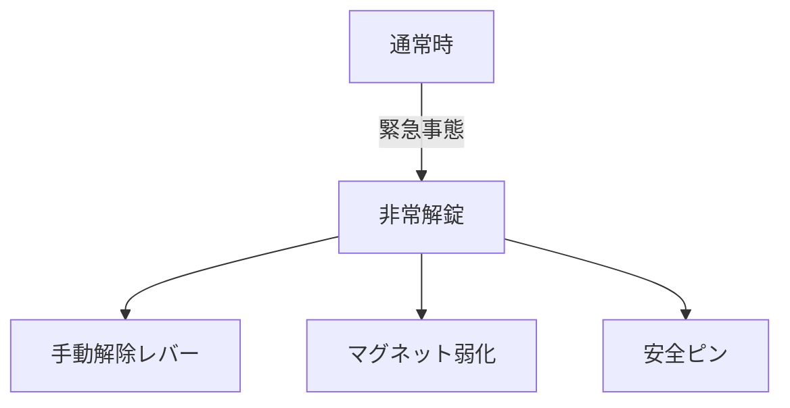

# Day 135: 非常解錠との関係

キャッチやマグネットキャッチは、ドアやカバーを閉じた状態で保持するための部品です。これらの部品は、通常の使用時にはしっかりと固定する役割を果たしますが、緊急時には迅速に解錠できることが求められます。この「非常解錠」とは、緊急時に手早くドアやカバーを開けるための仕組みを指します。

非常解錠機能は、例えば火災や地震などの緊急事態において、人命や設備の安全を確保するために重要です。通常のキャッチは強力な保持力を持っていますが、非常解錠機能があることで、緊急時には簡単に解除できるよう設計されています。

### 非常解錠の仕組み

1. **手動解除レバー**: 多くのキャッチには、手動で解除できるレバーが付いています。通常は目立たない位置にありますが、緊急時には簡単に操作できるようになっています。

2. **マグネットの弱化**: マグネットキャッチの場合、非常解錠時には磁力を一時的に弱める仕組みが組み込まれていることがあります。これにより、通常時の保持力を維持しつつ、緊急時にはスムーズに開けられます。

3. **安全ピン**: 一部のキャッチには、安全ピンが設けられており、これを引き抜くことで簡単に解錠できるようになっています。

これらの非常解錠機能は、特に公共施設や工場、病院などの安全性が重視される場所で重要です。設置場所や使用目的に応じて、最適な非常解錠機能を持つキャッチを選ぶことが大切です。

## 図で理解する

## 今日のポイント
- 非常解錠は緊急時の安全確保に重要
- 手動解除レバーやマグネット弱化が一般的
- 設置場所に応じた機能選択が必要

## 明日へのつながり
明日は、キャッチの耐久性とメンテナンスについて学びます。これにより、長期的な安全性を確保する方法を理解しましょう。
