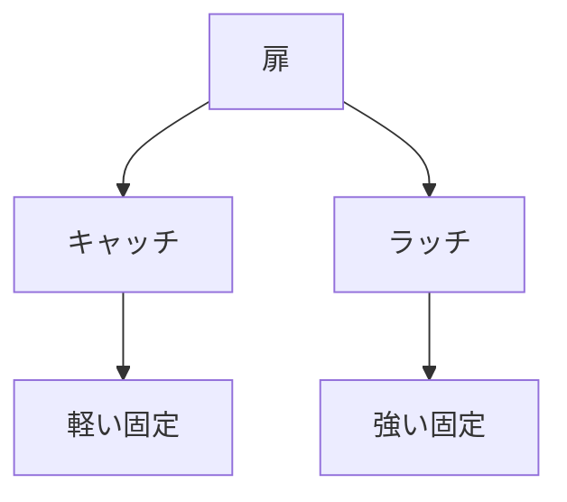

# Day 136: キャッチとラッチの使い分け

キャッチとラッチは、どちらも扉や蓋を固定するための部品ですが、その用途や構造によって使い分けが求められます。まず、キャッチとは、扉や蓋を閉じた状態で軽く固定する部品です。一般的に、キャッチはマグネットやバネの力を利用して、扉を閉じた状態に保ちます。これに対し、ラッチは、扉や蓋をしっかりと固定するための部品で、通常はレバーやボタンを操作して解除します。

### キャッチの特徴
キャッチは、主に軽い扉や頻繁に開閉される扉に使用されます。マグネットキャッチは、磁石の力を利用して扉を閉じた状態に保つため、開閉がスムーズで、力を入れずに操作できます。例えば、家具やキャビネットの扉に多く使われています。キャッチは、簡単に取り付けられ、メンテナンスも少なく済むため、コストパフォーマンスに優れています。

### ラッチの特徴
一方、ラッチは、より強い固定力が必要な場合に使用されます。例えば、工場の機械カバーや安全扉など、しっかりと閉じておく必要がある場所に適しています。ラッチは、レバーやボタンを操作することで開閉が可能で、誤操作を防ぐための機構が組み込まれていることが多いです。このため、安全性が求められる場面での使用に適しています。

### 使い分けのポイント
キャッチとラッチを使い分ける際のポイントは、使用する場所と求められる固定力です。軽い扉で頻繁に開閉する場合はキャッチが適しており、強い固定力が必要な場合や安全性が重要な場合はラッチを選ぶと良いでしょう。また、キャッチは取り付けが簡単でメンテナンスが少ないため、コストを抑えたい場合にも適しています。

## 図で理解する

## 今日のポイント
- キャッチは軽い扉に適する
- ラッチは強い固定が必要な場面に
- 用途に応じた使い分けが重要

## 明日へのつながり
明日は、キャッチとラッチの具体的な取り付け方法について学びます。これにより、実際の使用場面での選択がより明確になります。
