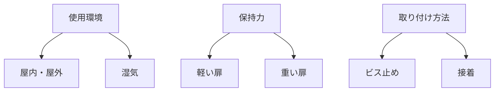

# Day 137: 選定チェックリスト

キャッチやマグネットキャッチは、ドアや扉を閉じた状態で保持するための重要な部品です。これらの部品を選定する際には、いくつかのポイントを押さえておく必要があります。今回は、図面が読めなくても理解できるように、選定時に確認すべき基本的なチェックリストを紹介します。

まず、キャッチやマグネットキャッチの選定において重要なのは、**使用環境**です。設置場所が屋内か屋外か、湿気が多い場所かどうかなどを確認しましょう。これにより、錆びにくい素材や防水性のある製品を選ぶことができます。

次に考慮すべきは、**保持力**です。保持力とは、キャッチがどれだけ強く扉を保持できるかを示す力のことです。軽い扉には弱い保持力でも十分ですが、重い扉には強い保持力が必要です。これを確認することで、扉がしっかりと閉まるようになります。

さらに、**取り付け方法**も重要です。キャッチの取り付けは、ビス止めや接着など様々な方法があります。取り付け場所の材質や構造に合わせて、適切な取り付け方法を選びましょう。特に、取り付けが難しい場所では、簡単に取り付けられるタイプを選ぶと良いでしょう。

これらのポイントを押さえることで、キャッチやマグネットキャッチを適切に選定することが可能になります。選定が適切であれば、扉の開閉がスムーズになり、使用者の安全性も向上します。

## 図で理解する

## 今日のポイント
- 使用環境に応じた素材選び
- 扉の重さに適した保持力
- 取り付け方法の確認

## 明日へのつながり
明日は、キャッチとマグネットキャッチの具体的な取り付け事例を学び、実際の使用シーンをイメージできるようにしましょう。
